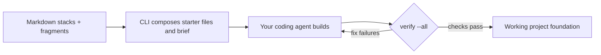

# stacks

`stacks` starts projects for coding agents. It writes starter files and a build brief from a recipe (a stack), hands the project to your coding agent, and runs the project's declared checks so you and the agent agree on when it's done. Browse the catalog at [stacks.steamfield.io](https://stacks.steamfield.io).

This repository holds the CLI, the shared format package and the MCP server. The hosted side (the catalog site, search and stats API) lives in a separate repository.

## How it works



A stack says what a project is made of, how it's laid out and what "working" means, and never names a version. Your agent installs current releases, builds the project from the brief and fixes whatever the checks catch. The CLI calls no model, needs no API key and runs nothing it reads from a stack; `verify` runs only the steps in your project's own manifest. [product/PROBLEM_STATEMENT.md](product/PROBLEM_STATEMENT.md) explains who it's for and why it's built this way.

Verification proves the declared checks pass, not that the application is good or ready for production. The usage and outcome numbers on the catalog site are seeded development data until real telemetry replaces them.

## Install and try it

stacks needs Node 22 or newer, on macOS or Linux.

```sh
npm install -g @steamfield/stacks@latest
stacks search "TypeScript command line tool"
stacks show typescript-cli
stacks new typescript-cli my-cli --sandbox
cd my-cli
# your coding agent reads .stacks/BRIEF.md and builds the project, then:
stacks verify --all
```

The package is `@steamfield/stacks` and the command is `stacks`; `npx @steamfield/stacks@latest <command>` works without installing. The [CLI README](packages/cli/README.md) explains each step, the bundled stacks and how agents drive it, and the [quick start](packages/cli/docs/quickstart.md) walks through a first project.

## What's here

| Path | What it is |
| --- | --- |
| [packages/cli](packages/cli/README.md) | `@steamfield/stacks`, the CLI: Effect 4 on Node, bundled by Bun. Holds the bundled registry of stacks and fragments, the agent skill and the [user docs](packages/cli/docs/README.md) |
| [packages/format](packages/format/README.md) | `@steamfield/stacks-format`, the contracts the CLI and the hosted API share: entry format, manifest, run records, telemetry events, bundles, the signed index and stats shapes |
| [packages/mcp](packages/mcp/README.md) | `@steamfield/stacks-mcp`, the MCP server: a stdio server on Effect's MCP modules that wraps the CLI's `--json` contract as typed tools and resources, so an agent whose client prefers MCP tools gets the same results and trust boundary |
| `product/` | The [problem statement](product/PROBLEM_STATEMENT.md), plus the pitch, prep notes and demo outline from the hackathon stacks was first built for |
| `.claude/`, [docs/harness.md](docs/harness.md) | The agent harness: hooks, rules, skills and agents, with their tests in `tests/hooks/` and `tests/scripts/` |

## Development

You need Bun 1.4.2 and Node 24 LTS. Install lefthook (`brew install lefthook` on macOS) and jq for the git hooks.

```sh
bun install                 # every package, plus the git hooks
bun run dev doctor          # the CLI from source
bun run dev new go-cli "$HOME/stacks-projects/my-cli" --sandbox --no-launch
bun run check               # lint, typecheck, every package's tests and e2e
```

Put projects you scaffold from source outside this checkout. `bun run dev` resolves paths against the directory you ran it from; [Configuration](packages/cli/docs/reference/configuration.md#the-development-wrapper) explains running it from inside a scaffolded project. To let your coding agent start projects from source, run `bun run dev skill install` once (`--project` installs it for the current repository only).

`bun run check` is the full gate and takes a few minutes. While you work, run the tests for what you changed (`bun run test:unit tests/<file>.test.ts` in `packages/cli`) plus `bun run lint` and `bun run typecheck`. [AGENTS.md](AGENTS.md) lists every command, the architecture and the conventions; it's written for coding agents and works for people too.

Commits follow Conventional Commits, checked by the commit-msg hook. Pre-commit formats staged files; pre-push runs lint and typecheck. CI (`.github/workflows/ci.yml`) runs the gate on Ubuntu for pushes to `main` and pull requests.

## Monorepo

Every package lives in `packages/<name>/` and is a bun workspace member (`"workspaces": { "packages": ["packages/*"] }` in the root `package.json`). There is one `bun.lock` and one `node_modules/` install at the root.

The root owns what applies to the whole repo: the agent harness (`.claude/`, `tests/hooks/`, `tests/scripts/`), lefthook, CI, the root `biome.json`, `tsconfig.base.json`, and the dependency catalog. It has no product code. Each package owns its source, tests, scripts, `tsconfig.json`, README, and any lint plugins of its own.

Root scripts (`build`, `typecheck`, `test`, `coverage`, `e2e`, `clean`) run `bun run --filter '*' <script>`, which runs that script in every package that defines it and skips the ones that don't. So a package joins the gate by defining the standard script names, and `bun run check` at the root is the gate for everything. Inside a package, the same script names run just that package. `bun run dev` at the root runs the CLI directly (`--cwd packages/cli`) because `--filter` prefixes each output line, which would break `--json`.

Dependency versions live once, in `workspaces.catalog` in the root `package.json`; packages depend on `"catalog:"` so every package gets the same Effect, TypeScript and Vitest. A package that depends on another one uses `"workspace:*"`. Shared code goes in its own package, never imported across another package's `src/`.

To add a package:

1. Create `packages/<name>/package.json` with a scoped name (`@steamfield/stacks-<name>`, the maintainers' npm scope), `"private": true` and `"type": "module"`, then run `bun install`.
2. Add `tsconfig.json` extending `../../tsconfig.base.json`, which has Node types only; add `"types": ["bun", "node"]` only if the package uses Bun APIs.
3. Define the standard scripts the package supports so the root gate runs them.
4. If it needs lint rules of its own, add a nested `biome.json` with `"root": false, "extends": "//"`.
5. If agents need package-specific guidance, add `.claude/rules/<name>/` scoped to `packages/<name>/`, and note the package in AGENTS.md.

## Releasing

Maintainers publish all three packages with `bun run release` from an up-to-date `main`; `bun run release:dry-run` packs them and publishes nothing, and `bun run release:format` publishes the format package alone. [packages/format/README.md](packages/format/README.md#publishing) has the steps and the checks the script makes.
