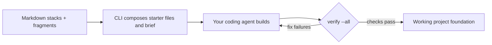

# stacks

stacks starts projects for coding agents: it writes starter files and a build brief, then runs the project's declared checks. Browse the catalog at [stacks.steamfield.io](https://stacks.steamfield.io), or follow the [quick start](packages/cli/docs/quickstart.md); the [docs index](packages/cli/docs/README.md) has everything else.

## Submission: architecture, demo, and data

Public repo: [steamfield/stacks](https://github.com/steamfield/stacks). The CLI uses TypeScript and Effect 4, bundled by Bun for Node 22+. Recipes are Markdown; your existing coding agent builds the application. The FastAPI + React example uses uv, pytest, Vite, and a generated OpenAPI client.



### Reproduce the local FastAPI + React demo

Install Node 22+, git, Bun, uv, make, jq, and lefthook, and authenticate your coding agent. From a fresh directory, use the published CLI version checked for this submission:

```sh
npx --yes @steamfield/stacks@0.5.0 show python-react
npx --yes @steamfield/stacks@0.5.0 new python-react stacks-demo --sandbox --no-launch
cd stacks-demo
cp .env.example .env
```

Open `stacks-demo` in your coding agent and ask: **“Read .stacks/BRIEF.md and implement it without weakening the checks; finish by running npx --yes @steamfield/stacks@0.5.0 verify --all.”** Then inspect the result:

```sh
npx --yes @steamfield/stacks@0.5.0 verify --all
npx --yes @steamfield/stacks@0.5.0 runs
make dev
```

Open `http://localhost:5173`; the API health endpoint is `http://localhost:8000/health`. Check that all required verification steps passed, since a partial run can also exit 0. Generation and timing vary with the agent and dependencies; this reproduces the workflow, not a historical timed run.

The CLI calls no model and needs no API keys or `.env`. Your agent needs its own provider login or credentials. The generated app includes a [sample `.env.example`](packages/cli/registry/stacks/python-react/files/.env.example) with local defaults:

```dotenv
PORT_API=8000
PORT_WEB=5173
ENVIRONMENT=development
LOG_LEVEL=INFO
CORS_ORIGINS=["http://localhost:5173"]
VITE_API_BASE_URL=
```

No Rho, database, or analytics key is needed for this local starter. Optional integrations need separate credentials. Keep secrets out of Git and browser-exposed `VITE_` variables. The CLI does not autoload `.env`; the generated app reads its own configuration.

### Data and provenance

No external dataset is required for the local starter. Recipes and starter assets are in the [maintainer-controlled registry](packages/cli/registry); inspect their Git history for provenance. The public [run ledger](packages/cli/registry/runs.json) records historical agent sessions, versions, fingerprints, outcomes, and steps. At this revision it contains 8 records: 7 labeled pass and 1 fail. Five records skip the production build. Full run narratives referenced under `plans/runs/` are not public; these summaries do not establish a current success rate or an 8.8-minute reproduction.

The directory's [stats API](https://stacks.steamfield.io/v1/stats) identified its population as **seeded development data** on October 29, 2026. Its synthetic usage and outcome metrics illustrate the analytics interface, not community adoption. The hosted implementation and seed generator are private, so this repo reproduces the CLI workflow rather than the site's synthetic dataset. Arrange judge access separately if evaluating the hosted code. Record your own session metrics with `stacks runs`; illustrative homepage timings are not controlled benchmarks.

### Limitations and next steps

The CLI supports macOS and Linux on Node 22+; recipes need their own tools and agent access. Verification proves only the declared checks, not application quality or production readiness. Hosted search can fall back to local ranking. The catalog and historical evidence are limited, directory metrics are synthetic, and the [MCP server](packages/mcp/README.md) is a placeholder. Next steps are broader recipe coverage, public reproducible run artifacts, real outcome data with appropriate disclosure, and MCP support.

## Install

stacks needs Node 22 or newer, on macOS or Linux. The npm package is `@steamfield/stacks`; run it with `npx`, no install step:

```sh
npx @steamfield/stacks@latest search "TypeScript command line tool"
npx @steamfield/stacks@latest show typescript-cli
npx @steamfield/stacks@latest new typescript-cli my-cli --sandbox
cd my-cli
# Have your coding agent read .stacks/BRIEF.md and build the project, then:
npx @steamfield/stacks@latest verify --all
```

`search` finds recipes in plain words; `show` lets you inspect the choice before writing anything. `new` writes the brief and hands it to your coding agent. The agent builds and fixes failures with `verify`; run `verify --all` before calling it done. `--sandbox` keeps the project local and uses default decisions.

Or install it globally. The package is `@steamfield/stacks`, but the command it puts on your PATH is `stacks`:

```sh
npm install -g @steamfield/stacks@latest
```

This repository is a bun workspace. The [product statement](product/PROBLEM_STATEMENT.md) describes its goals; internal plans are not included in the public checkout.

| Path | What it is |
| --- | --- |
| [packages/cli](packages/cli/README.md) | `@steamfield/stacks`, the CLI (installed as `stacks`): Effect 4, a Node 22+ bundle. `new <stack>` writes a project and the brief your coding agent builds it from; the bundled stacks are listed in its README |
| [packages/mcp](packages/mcp/README.md) | `@steamfield/stacks-mcp`, the MCP server (placeholder, no code yet) |
| `.claude/`, `docs/harness.md` | The agent harness: hooks, rules, skills and their tests in `tests/hooks/`, and the acceptance trace in `tests/acceptance/` |

## Development quick start

Use Bun 1.4.2 and Node 24 LTS. Install lefthook (`brew install lefthook` on macOS) and jq for the development hooks.

```sh
bun install
bun run dev doctor --json   # the CLI from source
bun run check               # lint, typecheck, root tests, every package's tests and e2e
```

Choose a destination outside this checkout. Start a project yourself with `bun run dev new astro-blog "$HOME/stacks-projects/my-blog"`, or run `bun run dev skill install` once and ask your coding agent to start one. The skill guides it through choosing a stack, reading the brief and building until verify passes. Use `--project` to install it only for the current repo, or `--print` to copy it elsewhere.
See [AGENTS.md](AGENTS.md) for the full command list.

## Monorepo

Every package lives in `packages/<name>/` and is a bun workspace member (`"workspaces": { "packages": ["packages/*"] }` in the root `package.json`). There is one `bun.lock` and one `node_modules/` install at the root.

The root owns what applies to the whole repo: the agent harness (`.claude/`, `tests/hooks/`, `tests/acceptance/`), lefthook, CI, the root `biome.json`, `tsconfig.base.json`, and the dependency catalog. It has no product code. Each package owns its source, tests, scripts, `tsconfig.json`, README, and any lint plugins of its own.

Root scripts (`build`, `typecheck`, `test`, `coverage`, `e2e`, `clean`) run `bun run --filter '*' <script>`, which runs that script in every package that defines it and skips the ones that don't. So a package joins the gate by defining the standard script names, and `bun run check` at the root is the gate for everything. Inside a package, the same script names run just that package. `bun run dev` at the root runs the CLI directly (`--cwd packages/cli`) because `--filter` prefixes each output line, which would break `--json`.

Dependency versions live once, in `workspaces.catalog` in the root `package.json`; packages depend on `"catalog:"` so every package gets the same Effect, TypeScript and Vitest. A package that depends on another one uses `"workspace:*"`. Shared code goes in its own package, never imported across another package's `src/`.

To add a package:

1. Create `packages/<name>/package.json` with a scoped name (`@steamfield/stacks-<name>`, the maintainers' npm scope), `"private": true` and `"type": "module"`, then run `bun install`.
2. Add `tsconfig.json` extending `../../tsconfig.base.json`, which has Node types only; add `"types": ["bun", "node"]` only if the package uses Bun APIs.
3. Define the standard scripts the package supports so the root gate runs them.
4. If it needs lint rules of its own, add a nested `biome.json` with `"root": false, "extends": "//"`.
5. If agents need package-specific guidance, add `.claude/rules/<name>/` scoped to `packages/<name>/`, and note the package in AGENTS.md.
