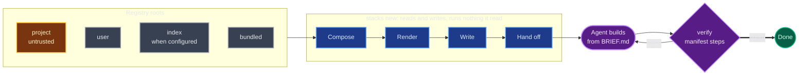
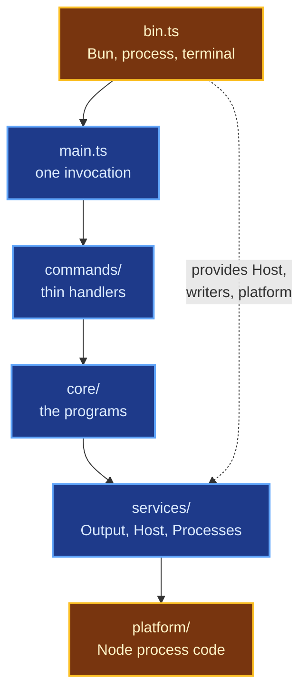

# How stacks works

stacks is a compiler for project setups. Its input is a set of Markdown entries (stacks and fragments), and its output is a project directory with a brief and a manifest. A coding agent turns that into working code, and `verify` checks the result. This page covers the pipeline, the rules the design keeps, and how the source is organized. For the vocabulary, read [Concepts](concepts.md) first.

## The pipeline

Blue stages are the CLI writing files; purple is the agent's loop, where the only command stacks runs is `verify`.

Each stage is a separate module with one job, and the first four are pure in the sense that matters here: they read files and write files, and never run anything they read.

Compose (`src/core/compose/`) resolves the stack id across project, user, index and bundled origins, applies `required`, `default`, `--with` and `--without`, follows `requires` and checks `conflicts` and `applies_to`. Its output, a `Composition`, lists every entry with its decisions, dependencies, commands, environment defaults and verify steps, in a fixed order.

`core/remote-index.ts::RemoteIndex` owns bounded HTTP reads, signature and digest verification, freshness and failure backoff. The registry preserves local precedence and bundled identity for equal digests. An index stack carries the exact fragment snapshot named in its proof; an unavailable bundle falls back to the complete bundled composition. `doctor` inspects cache state without refreshing, and `verify` never reads the index. Remote data cannot start a process.

`bin.ts` supplies the optional official index URL alongside its key list. Production currently supplies no URL. Config reads only `STACKS_INDEX_URL`, which overrides the supplied URL; with neither, the origin is off, returns no index, and makes no HTTP requests. Doctor reports `url: null` and `isDefaultUrl: false` when off. Only an effective URL matching the supplied official URL takes the signature-checked trust path; other URLs are untrusted.

Render turns a composition into bytes. One function, `composeFiles`, renders every planned file (copying, filling `.tmpl` templates, deep-merging JSON files that several entries ship), and `renderBrief` writes the brief. Because rendering is deterministic, stacks can fingerprint a composition: the same stack, fragments and preset always hash the same, which is how the bundled ledger knows whether a recorded run still describes the current stack.

Write (`src/core/scaffold/write.ts`) is the only code that writes into a project. It refuses any path that resolves outside the project's real path, creates files exclusively so it never overwrites, and rolls back everything it wrote if a later step fails or you press Ctrl+C.

Hand off decides what happens next, by the first rule that matches. Inside an agent session, stacks prints a "NEXT STEP FOR THE AGENT" line. With `--json`, `--dry-run`, `--no-launch`, a non-terminal or any untrusted entry, it prints the prompt. Otherwise `--launch` selects a harness explicitly, or the first available agent in the `agents` setting launches. Without an available configured agent, one found harness launches immediately, and several show a numbered picker after the summary. The order is `claude`, `codex`, `opencode`, `cursor-agent`, `copilot`, then the Codex app on macOS. Terminal agents receive the prompt and terminal in the project; the app opens a project URL and exits 0. The [command reference](reference/commands.md) has the full rule order and app detection requirements.

## The rules the design keeps

Most of the structure exists to enforce these.

stacks executes nothing it reads. `list`, `show`, `new`, `add`, `validate` and `create` read, compose and write. Only `verify` runs commands, and only the steps in the project's own manifest. The CLI's own programs are fixed: git (`new` runs `git init` in a fresh target, and `new` and `add` read the repository root and author name), the agent you chose at handoff, which an untrusted entry never launches, and npm from `update`, with fixed arguments and a checked version, only when you run that command. None of them take a command from an entry. A stack can't run a generator, an install script or a hook at scaffold time, however convenient that would be. This is what makes it safe to try a stack: `new` on an entry you've never seen writes files, runs `git init` and launches nothing.

People own what lasts and agents own what ages. Layout, enforcement and the definition of done live in stacks. Versions, generator flags and config formats belong to the agent, which looks them up when it builds. `validate` warns when an entry pins a version or ships a version-sensitive config file, because the CLI would otherwise drift into being a template engine whose templates go stale.

The definition of done is tamper-evident. The verify steps are digested into the manifest and into a state record outside the project, and verify refuses to run steps that don't match. Only a person can accept a change. [Concepts](concepts.md#why-verify-checks-its-own-steps) explains the mechanism.

Trust follows origin. Entries from the project root, from a configured `STACKS_INDEX_URL` and from a `STACKS_REGISTRY_DIR` override are untrusted: they still compose, but they never auto-launch an agent and an agent is told to ask first.

## Three audiences, one result

The CLI's main reader is a coding agent, and its fallback reader is a person at a terminal. Every invocation picks one audience once, at startup:

| Audience | When | What it gets |
| --- | --- | --- |
| `json` | `--json` | One result object on stdout; one error envelope as the last stderr line on failure |
| `human` | stdout is a terminal, no agent is detected and `CI` is unset | Full text, progress lines, logs on stderr |
| `agent` | everything else: an agent's shell, a pipe, CI | The human text with the noise removed |

Agent text is the human text minus what an agent doesn't need (passed verify rows, file listings the brief already has, logs). The audiences never behave differently: exit codes, files written and side effects are the same in all three. [Output and errors](reference/output.md) has the details.

Exit codes are fixed per error and chosen by what the caller should do next (2 fix the input, 5 read the verify report, 6 ask a person), so an agent can branch on the number without parsing text. A signal stops a command after its cleanup runs (a second one a second or more later skips the cleanup), and child processes are killed as a group. Both are tabulated in [Output and errors](reference/output.md).

## Source layout

The CLI is TypeScript on [Effect](https://effect.website), bundled by Bun into one Node ESM file and run and tested on Node. Paths are under `packages/cli/src/`:

| Layer | Path | Job |
| --- | --- | --- |
| Boundary | `bin.ts` | The only place that touches Bun, the real process and the terminal. Builds `Host` (paths, TTY facts), installs signal handling, sets the exit code |
| Invocation | `main.ts` | Runs one command: parses argv, captures framework output, reports one failure, logs one `command` record |
| Commands | `cli.ts`, `commands/` | The command tree. Each handler is thin: read flags, call core, hand the result to `Output` |
| Core | `core/` | The programs: registry, compose, brief, scaffold, add, validate, verify, ledger. No Node or Bun APIs, so it runs unchanged under tests |
| Services | `services/` | `Output` (audience and writing), `Host`, `Processes` (every child process), `Tcp` |
| Telemetry | `telemetry/` | Fresh consent, validated anonymous events, private identities and spool; bounded delivery before agent launch and after verify |
| Platform | `platform/` | The only Node process code: spawning, process groups, signals, HTTP |
| Schemas | `schemas/` | Effect Schemas for every input and every JSON result |

Two boundaries matter most. Only `bin.ts` and `platform/` (amber above) may use Node process APIs, and only `config.ts` reads environment variables; lint rules enforce both. Everything else gets those facts through services, which is why the whole command tree can run in a test with an in-memory terminal and a temporary home directory.

For a file-by-file map, see the "Architecture map" in the repository's `AGENTS.md`.
