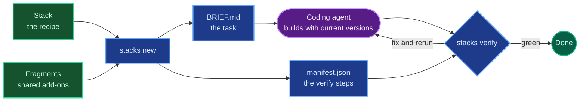
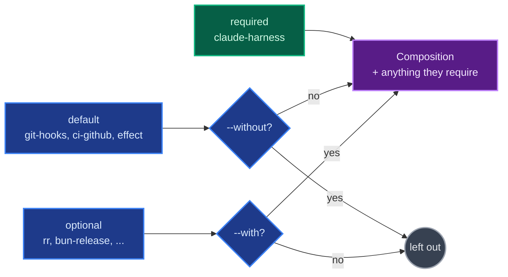
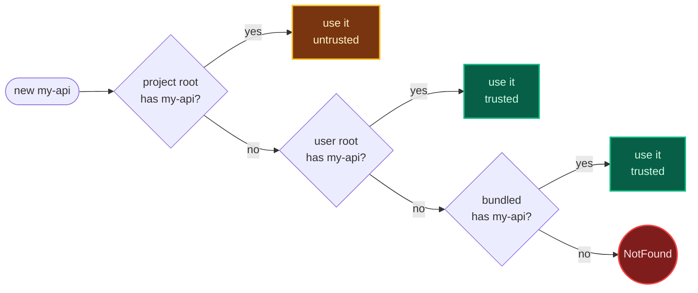
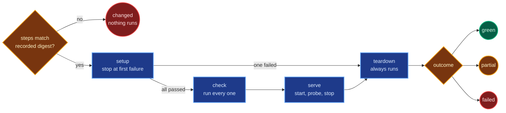
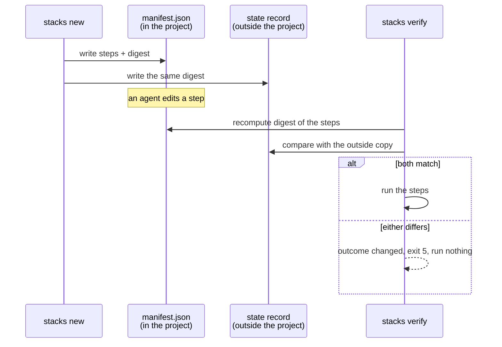

# Concepts

stacks has a small vocabulary: stacks, fragments, the brief and verify. Once those four click, every command makes sense. This page explains each one with a real example from the bundled registry, then covers how they combine and what ends up in your project.

## The idea in one paragraph

Starting a project well takes judgment that doesn't change much from year to year (how to lay it out, what to test, what "done" means) and details that change constantly (package versions, generator flags, config file formats). stacks splits the two. A person writes down the lasting part once, as a stack. A coding agent supplies the current details every time it builds one, by reading today's docs. The CLI's job is to hand the agent the lasting part as a brief, and then hold it to a definition of done it can't quietly lower.



Green boxes are written by people, blue is the CLI and what it writes, and purple is the agent.

## Stacks

A stack is a recipe for one kind of project. `typescript-cli` is a Bun-compiled CLI built on Effect; `astro-blog` is a static blog; `python-react` is a FastAPI backend with a React frontend.

A recipe lists ingredients and steps, but it doesn't tell you which brand of flour to buy. A stack works the same way. It names the packages a project needs by role ("Effect for services, Vitest for tests") but never pins a version. It describes the layout and the rules ("stdout carries results only; every error maps to a fixed exit code") but leaves the config files for the agent to generate with current tools. Then it says how to prove the result works: a list of commands that must pass.

`stacks list stacks` lists them and `stacks show <id>` shows one in full.

## Fragments

A fragment is one capability that several stacks can share: GitHub Actions CI, lefthook git hooks, a Postgres database, Cloudflare deployment. Without fragments, every stack that wanted CI would carry its own copy of the CI instructions, and they'd drift apart.

Each fragment has a category that says what kind of thing it adds:

| Category | Adds | Example |
| --- | --- | --- |
| `agent-ops` | Agent configuration and guardrails | `agent-ops`, `claude-harness` |
| `ci` | Continuous integration | `ci-github` |
| `deploy` | Deployment | `cloudflare-pages`, `docker-deploy` |
| `release` | Building and publishing releases | `bun-release`, `goreleaser` |
| `service` | A backing service | `postgres`, `cloudflare-d1` |
| `vendor` | A third-party service | `clerk`, `posthog` |
| `tooling` | Developer tooling | `git-hooks`, `effect` |
| `app` | A whole application on top of a stack | `openrouter-chat` |

An app is a fragment with `category: app`. It's the one category that adds a product rather than infrastructure: `openrouter-chat` turns a bare `react-router` project into a streaming chat app. Apps get a bigger word budget, and their steps run in a second verify stage after the base project passes.

## How a stack and its fragments combine

A stack sorts its fragments into three groups:

```yaml
fragments:
  required: [claude-harness]           # always included
  default: [git-hooks, ci-github, effect]  # included unless you say --without
  optional: [rr, ce-plugin, bun-release, openrouter-chat-cli]  # only with --with
```



`--without ci-github` drops CI. `--with bun-release` adds release tooling. A required fragment can't be removed, because the stack depends on it.

Fragments also describe how they fit with others. `requires` pulls in another fragment automatically: `claude-harness` requires `agent-ops` and `effect` requires `effect-schema`, so `stacks new typescript-cli my-cli` gets six fragments, `agent-ops`, `ci-github`, `claude-harness`, `effect-schema`, `effect` and `git-hooks`, though the stack names only four. `conflicts` names fragments it can't coexist with. `applies_to` says which stacks or tags it works with, so `postgres` (which says `applies_to: [python-react, python-api]`) doesn't get offered for an Astro blog.

Picking the fragments and putting the result together is called composition. Composition is the same every time for the same inputs, and `stacks validate` composes every stack with every fragment that fits it to catch combinations that don't work.

### Presets

A preset changes how composition treats the project. There are two:

- `default`: the agent asks you about each decision, and deploy and release fragments are included when the stack defaults to them.
- `sandbox` (`--sandbox`): local only. The agent takes the default for every decision without asking, deploy, release and app fragments stay out unless you name them with `--with`, and verify steps tagged `prod` are skipped.

Sandbox is the quickest way to see a stack working. Default is what you want for a real project.

## Anatomy of an entry

"Entry" means a stack or a fragment; both are built the same way. Each one is a directory:

```text
stacks/typescript-cli/
  STACK.md            # frontmatter + guidance for the agent
  files/              # starter files copied into every project
  adapters/claude/    # files copied only when Claude Code is a target agent
```

A fragment has `FRAGMENT.md` instead of `STACK.md`. Everything else is the same.

### The frontmatter

The top of `STACK.md`, between two `---` lines, is YAML that the CLI reads. Here is `typescript-cli`'s, trimmed:

```yaml
schema_version: 1
id: typescript-cli
kind: stack
name: TypeScript CLI with Effect
description: A Bun-compiled TypeScript CLI with Effect commands and services, ...
tags: [typescript, cli, effect, bun, scripts, node]
deps:
  app: [effect, "@effect/platform-bun"]
  dev: ["@effect/platform-node", typescript, "@biomejs/biome", vitest]
tools: [bun, node, git]
decisions:
  - "Node version: current LTS (default), recorded in .node-version and engines.node."
fragments:
  required: [claude-harness]
  default: [git-hooks, ci-github, effect]
verify:
  - { name: install, phase: setup, layer: install, run: bun install }
  - { name: lint, layer: lint, run: bun run lint }
  - { name: test, layer: test, run: bun run test }
commands:
  install: Install dependencies with bun
  lint: Run Biome checks
  test: Run the unit suite
```

Each key has one job:

| Key | What it says | Who uses it |
| --- | --- | --- |
| `id`, `name`, `description`, `tags` | What this is, for `list` and for picking | You and the agent choosing a stack |
| `deps` | Packages by role, names only, never versions | The agent, which installs current versions |
| `tools` | Programs that must be on PATH | `new` warns when one is missing |
| `decisions` | Choices the agent asks you about, each with a default | The brief's "Decisions" section |
| `fragments` | Required, default and optional fragments (stacks only) | Composition |
| `verify` | The commands that define done | The manifest, then `verify` |
| `commands` | Every project command and what it does | The brief, and `validate`, which checks verify only uses declared commands |
| `env` | Default environment values, such as ports | `verify`, when you haven't set them |
| `merge` | JSON files to deep-merge when several entries ship one | Composition |

Fragments add `category`, `applies_to`, `requires`, `conflicts`, `requires_tools` (a tool this fragment can't work without; the warning names the `--without` flag that avoids it) and `needs_own_repo` (the fragment must be the root of its own git repository).

Keys are snake_case in the file. Unknown keys are errors, so a typo like `appliesTo` fails `validate` instead of being ignored. CLI output spells the same fields in camelCase (`appliesTo`).

### The guidance

Everything after the frontmatter is Markdown prose for the agent: how to lay the project out, how to set it up, the rules it must keep, the mistakes to avoid. The CLI copies it into the brief under the entry's name.

Prose can vary by composition. A block between two markers is included only when its condition holds:

```md
<!-- stacks:when with=ci-github -->
CI uses Bun's packageManager and Node's .node-version ...
<!-- stacks:end -->
```

That paragraph appears in the brief only when `ci-github` is part of the project. The conditions are `with=<fragment>`, `preset=<preset>`, `stack=<id>`, `tag=<tag>`, `tag!=<tag>` and `mode=<new|add>`.

### Files and adapters

`files/` holds starter content the agent shouldn't have to rewrite: a `.gitignore`, shared scripts, hook code. Files are stored under their real names, so `files/.gitignore` becomes `.gitignore`. A file ending in `.tmpl` is a template, and a small fixed set of variables is filled in: `{{project_name}}`, `{{project_slug}}`, `{{env_prefix}}`, `{{package_scope}}`, `{{author}}` and `{{year}}`. Everything else is copied byte for byte.

`adapters/<agent>/` holds files for one coding agent: Claude Code settings under `adapters/claude/`, Codex config under `adapters/codex/`, and so on for `opencode` and `cursor`. Only the agents you target (`--agents`, default `claude`) get their adapter files. Every target gets `AGENTS.md`.

## Where entries come from

stacks reads entries from three places, called roots, and the first one that has an id wins:

| Origin | Where | Trusted |
| --- | --- | --- |
| `project` | `.stacks/stacks/` and `.stacks/fragments/` in the current directory | No |
| `user` | `~/.config/stacks/` (or `$XDG_CONFIG_HOME/stacks/`) | Yes |
| `bundled` | The registry shipped with the CLI | Yes |

A fourth origin, `index`, sits between user and bundled when you point `STACKS_INDEX_URL` at a remote registry index. It is off by default, and its entries are untrusted; [Configuration](reference/configuration.md#remote-registry-cache) has the details.



A higher root's copy hides the lower ones; `list --json` marks it with the origins it `shadows`. An entry that fails to load is listed as rejected and never silently replaced by a lower copy.

Project entries are untrusted because a repository you just cloned can contain them, and you didn't write them. An untrusted entry still works, but stacks never launches an agent on one automatically, an agent is told to stop and ask you first, and copying one into your user registry needs you at a terminal to read the full report.

Your own stacks and fragments go in the user root. `stacks create stack my-api` starts one there; [the authoring guide](authoring.md) walks through writing it.

## The brief

`new` and `add` write `.stacks/BRIEF.md`, the agent's entire task. It's assembled from fixed CLI text and the composed entries:

1. A header: stack, fragments, preset, target agents, and the files stacks wrote.
2. "Your job", "Versions" and "Ground rules": the same for every project. Use current versions, prefer official generators, never weaken verify.
3. "Decisions": every entry's decisions, each with its default. With `--yes` or `--sandbox`, the agent takes the defaults without asking.
4. "Dependencies and tools": packages by role, and any tools missing from PATH.
5. One section per entry: the stack's guidance, then each fragment's.
6. "Definition of done": the verify steps, and what to do after green (manual QA, checking the docs, writing notes).

Briefs are long, often 4,000 words or more, and that's deliberate. The agent reads the whole thing once, and everything it needs is in one place. `validate` holds them to a budget (6,000 words, 9,000 with an app) so they stay readable.

## The project after `new`

`new` leaves a normal project with a `.stacks/` directory:

| Path | What it holds | Committed |
| --- | --- | --- |
| `.stacks/manifest.json` | The stack, fragments, preset, agents, commands, environment defaults and verify steps, plus a digest of the steps | Yes |
| `.stacks/BRIEF.md` | The agent's task | No |
| `.stacks/NOTES.md` | The agent's notes: questions it asked under "Asked", problems with the brief under "Findings" | No |
| `.stacks/state/runs.jsonl` | One line per verify run | No |
| `.stacks/incoming/` | Files `add` couldn't write because the project already had them | No |

The manifest is the part that lasts. It's committed with the project, so anyone who clones it can run `stacks verify` and get the same checks.

There is one more record, outside the project: a state record under `~/.local/state/stacks/projects/`. It holds a second copy of the steps' digest and the project's timings (when it first went green). The next section explains why it exists.

## Verify

`verify` reads the manifest and runs its steps. Nothing else: it never runs a command from a stack or fragment directly, only what the manifest lists.

Each step has a phase, and phases run in order:

| Phase | What it's for | Failure behavior |
| --- | --- | --- |
| `setup` | Installing dependencies, starting a database | The first failure stops setup and skips the checks |
| `check` | Lint, typecheck, tests, file checks | Every check runs, so one run shows every failure |
| `serve` | Starting the app and probing it over HTTP | The server is started, probed until it answers, then stopped |
| `teardown` | Stopping what setup started | Always runs, even after a failure or Ctrl+C |



Each step also has a layer that says what it proves: `install`, `lint`, `typecheck`, `test`, `build`, `serve`, `docs` or `check` (a file check, such as "the README has no fill-in markers"). `validate` requires every stack to cover install, lint, typecheck and test, plus a probed server for web and API stacks.

A run ends with one outcome:

- `green`: every step ran and passed. The project is done.
- `partial`: every step that ran passed, but some were left out on purpose (`--only lint`, `--skip-tag slow`). Useful while fixing; never counts as done.
- `failed`: a step failed. Verify exits 5 and prints which step, its command and the end of its output.
- `changed`: the steps don't match the recorded copy, so nothing ran.

### Why verify checks its own steps

An agent that's been stuck on a failing test for an hour has an easy way out: edit the test step to `true`. Verify is designed so that doesn't work.

When `new` writes the project, it records a digest (a fingerprint) of the verify steps in two places: the manifest, and the state record outside the project. Before every run, verify recomputes the digest and compares. If either copy disagrees, verify runs nothing and reports `changed`, naming the steps that were edited, added or removed.



Because one copy lives outside the project, editing project files can't hide the change. The only way forward is `stacks verify --accept-changes`, which a person runs at their own terminal. It's refused when an agent is detected or stdin isn't a terminal.

A fresh clone has no state record on that machine, so verify checks the manifest's copy only and says so (`tamperCheck: "manifest-only"`).
