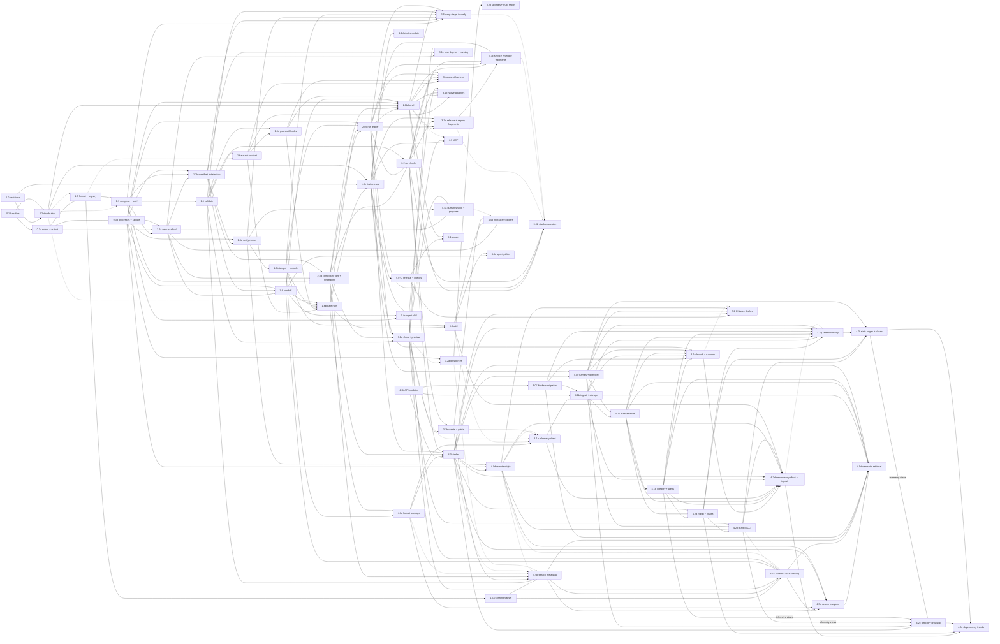

# Roadmap: phases and sub-phases

Status: DRAFT 2026-10-26, written to the demo-first proposal (D23). Proposed, not agreed
with the maintainers.
Settled decisions are only in the [README decisions log](README.md#decisions-log);
proposals are in [requirements.md](requirements.md#proposed-decisions).

## TL;DR

Six phases. Phases 0 and 1 are the MVP: the core loop from the problem statement, run
from the repo or the compiled binary, over the bundled catalog. The MVP is the demo.
Packaging for npm (0.2), reserving the name and publishing (1.6c) are the final step
before public release, after the [feature gaps](#feature-gaps-to-close-before-release)
are closed. After it, the order is local proof, then reach, then scale, then automation:

1. Phase 2: stacks prove themselves on a maintainer's machine. Run records, a ledger, a
   fingerprint, a bench that drives the user's own agent headlessly, and the
   deterministic checks that catch rot without an LLM.
2. Phase 3: existing repos and authors. `add`, personal and team stacks, authoring
   tools, (only once someone outside asks) git sources, and a wider bundled catalog with
   native config for more agents and apps built on stacks.
3. Phase 4: the hosted side. An Effect API in the private `stacks-api` repository
   (D35), on Node first and Workers later, that serves a signed
   registry index, opt-in or opt-out usage telemetry (the maintainers' call) with
   integrity checks and a launch runbook, public stats, a browsable directory, dependency
   trends, and an MCP server in `packages/mcp` once there is evidence agents want one.
4. Phase 5: CI and scheduled inference. The release workflow with provenance, extra CI
   jobs, the scheduled canary, and building, signing and deploying the index from CI.
   Everything here waits so the demo comes sooner (D23); the local behavior the earlier
   phases build stays where it is.

Every sub-phase is one file in [phases/](phases/), sized for one agent in one session.

## How the files are numbered

`phases/phase-<phase>.[letter]-<slug>.md`, for example
`phase-1.4-handoff-and-entry-points.md`. The phase number is the release-level
grouping. The sub-phase number starts at 0 in every phase, and `.0` is the spine: the
sub-phase the rest of the phase builds on. Higher numbers are not a strict order; the
dependency graph below says what can run in parallel. A sub-phase that is too big for one
session splits by appending a letter to its number and keeping a slug, for example
`phase-1.3a-verify-runner-and-probes.md` and
`phase-1.3b-tamper-detection-and-run-records.md`. The numbers of its siblings never change,
the same way decision IDs never change, and a split sub-phase has no file with the bare
number. Letters are not an order either: 1.6d runs before 1.6b, and 2.0c before 2.0b.

Phase 2 has no 2.1: scheduled reruns are phase 5 (5.1, under D23).

Each sub-phase file opens with its `Status:` line, then a table of goal, traces to,
depends on, blocks and decisions needed, then scope, design, files touched, acceptance
tests, exit criteria and what the plan may get wrong. Exit criteria always include
`bun run check` from the repo root. A sub-phase that uses a contract from
[Contracts every sub-phase shares](#contracts-every-sub-phase-shares) cites it by name and
never restates it.

## MVP cutline

The MVP is everything in phases 0 and 1, and nothing else. It is done when all of this is
true:

- `stacks list --json` works from the repo (`bun run dev`) or the compiled binary on
  macOS and Linux. `npx stacks@latest` (D12, D22) is the release step's, not the
  MVP's.
- `stacks new <stack> <dir> --sandbox` writes the starter files,
  `.stacks/BRIEF.md` and `.stacks/manifest.json`, runs no command from any
  entry, and hands off to the agent on PATH, to the agent that called it, or prints the
  prompt.
- `stacks verify` runs the manifest's steps in phases, probes dev servers, always
  runs teardown, and fails (not warns) when the steps were changed since `new` wrote them
  (D14, proposed).
- `stacks validate` enforces the brief budget (D5) and the verify layers (D7) on the
  bundled registry, and the bundled registry passes it with zero errors and zero warnings.
- The gate rule (D20, proposed): every bundled stack has at least one recorded
  `new --sandbox` run that reached a green `verify` with zero interventions and
  `tamperCheck: "full"`, with its time to green, time to first passing test, verify count,
  brief size and repo commit written down. Two of three green on the first attempt is the
  success-rate target, not the gate. One stack's composed brief is near 3,000 words and
  one is near 5,000 (D13), so the long-brief assumption gets a first data point.
- A2-A4 are in the README decisions log before the package is published, because exit 5,
  the `details` envelope and the signal policy are permanent once agents depend on them.
- Publishing is not part of the MVP. A maintainer publishes to npm by hand (1.6c) as the
  final step before public release, after 0.2 packs the CLI and the name is reserved. The
  tag-driven release workflow and npm provenance are phase 5 (5.0).

Below the cutline, on purpose: `add`, `show`, `new --dry-run` and the naming options
(3.1c), authoring skeletons, the agent skill (3.4c), the rot checks beyond budget and
layers (2.2), third-party sources, the bench, telemetry, the API, the MCP server, and
every CI change. Some of these must still land before the public release; they are listed
in [Feature gaps to close before release](#feature-gaps-to-close-before-release).

## Phases and sub-phases

### Phase 0: foundation

Goal: the name is held, the decisions that are hard to reverse are made, the package can
be installed with `npx`, and the CLI base can run long and interactive commands. No
product behavior yet.

| Sub-phase | Goal | Traces to | Depends on | Status |
|---|---|---|---|---|
| [0.0 Decisions and name](phases/phase-0.0-decisions-and-npm-name.md) | `stacks` reserved on npm; the MVP-gating proposals decided or deferred with a reason; A2-A4 reviewed; first stack named | Open question "Is the npm name available?"; open questions on brief budget and registry audience | nothing | In progress (owner: maintainers). Name check done; npm reservation and non-blocking decisions deferred 2026-10-26 |
| [0.1 Repo baseline](archive/phases/phase-0.1-repo-baseline-2026-10-30.md) | The ported base, workspace move and review fixes committed, CI `ci-ok` green on `main` | "What has to be true for it to be worth building": a trustworthy base (D10, D11) | nothing | Executed 2026-10-26 |
| [0.2 Distribution](archive/phases/phase-0.2-npm-distribution-artifact-2026-10-30.md) | A1 answered: a Node ESM bundle packed with `bun pm pack`, a Node floor check before Effect loads, bundled assets found at runtime, local e2e against the packed tarball | Open question on the npm name; the README's first command `npx stacks new` | 0.0 (A1, D12, D22), 0.1 | Executed 2026-10-27: shipped as `@steamfield/stacks` 0.1.0 (D34) |
| [0.3a Errors and output](archive/phases/phase-0.3a-errors-and-output-2026-10-30.md) | A2 and A4: one error table, closed `details`, exit 5, results kept on report-carrying failures, live progress on stderr | Agent as the main reader ("a verify command that doesn't exist", "ambiguity") | 0.1 | Executed 2026-10-26 |
| [0.3b Processes and signals](archive/phases/phase-0.3b-processes-and-signals-2026-10-30.md) | The `Processes` service (process groups, bounded tails, drain, `which`) and A3, the signal policy for interactive children | The CLI hands off "to the agent the user already has"; verify runs long commands | 0.3a | Executed 2026-10-26 |

0.2 keeps its number but runs last: on 2026-10-26 the maintainers deferred distribution
because the prototype runs from the repo. Packaging (0.2), reserving the npm name (0.0)
and publishing (1.6c) are together the final step before public release, after the
[feature gaps](#feature-gaps-to-close-before-release) are closed; none of them comes
before 1.6b. Until then phase 1 uses the stubs its files already describe (a stub
registry path, `Host.invocation` fixed to `stacks`), and 1.6b's gate runs use the
compiled binary, or a packed tarball if 0.2 has landed by then.

### Phase 1: the core loop (MVP)

Goal: an agent can run `list --json`, `new --sandbox`, read the brief and loop on `verify`
to green on the bundled stacks, from the repo or the compiled binary. Publishing (1.6c) is
listed at the [end of the plan](#release-the-final-step).

| Sub-phase | Goal | Traces to | Depends on | Status |
|---|---|---|---|---|
| [1.0 Entry format and registry](archive/phases/phase-1.0-entry-format-and-registry-2026-10-30.md) | Entry format v1 as amended (D18: snake_case frontmatter, literal dotfiles, apps as `category: app` fragments, `expect` on verify steps), `AgentId` and `DetectedAgent`, origins with `origin` and `trusted` marks (D19), `list [stacks\|fragments\|apps]` and `list --json` | Job 5 ("a target I can verify against"); the agent "runs `list --json`, picks a stack" | 0.3a (`Host.stdoutIsTTY`); 0.2 soft (registry path; a stub path works until then) | EXECUTED 2026-10-26; reviewed, fixed, merged to main (PR #4) |
| [1.1 Composition and the brief](archive/phases/phase-1.1-composition-and-brief-2026-10-30.md) | Fragment composition (including at most one app, ordered last), conditional prose, decisions, the commands map, the brief with its verify table (split into base and application when an app is present), and `countWords` | The brief "must say which layers of testing", "a default for every decision" | 1.0; 0.2 soft (`Host.invocation` is stubbed as `stacks` until 0.2 lands) | EXECUTED 2026-10-26; reviewed, fixed, merged to main (PR #4) |
| [1.2a `new`: scaffold and templates](archive/phases/phase-1.2a-new-scaffold-and-templates-2026-10-30.md) | Files written with single ownership and JSON merge through a real-path writer with rollback, `*.tmpl` templates (including `package_scope` from `--scope`), literal dotfiles, the ASCII slug, git init, missing tools, `--sandbox`, `--with`, `--without`, `--yes`, `--agents`, and the `new --json` result with `briefWords` and `fixedWords` | Job 1, job 2; "writes a few files and a brief"; "never runs a command from a stack" | 1.1, 0.3a, 0.3b | EXECUTED 2026-10-26; batch-reviewed, fixed, merged to main (PR #4) |
| [1.2b `new`: manifest, state record and detection](archive/phases/phase-1.2b-manifest-state-and-detection-2026-10-30.md) | The manifest with its step digest, the out-of-project state record, `TargetNotEmpty`'s `scaffold` detail, agent detection (`AgentMarkers`, `AppConfig.agent: DetectedAgent`) and the marker list `childEnv` strips | Job 5; the trust paragraph ("why the brief refuses to let the agent weaken a step") | 1.2a, 1.1, 0.3b | EXECUTED 2026-10-26; batch-reviewed, fixed, merged to main (PR #4) |
| [1.3a `verify`: runner and probes](archive/phases/phase-1.3a-verify-runner-and-probes-2026-10-30.md) | Phased step runner with timeouts, `expect.http` probes, self-backgrounding detection, teardown, the result (built-in file checks are an open additive item) | "verify as the definition of done"; success rows 1-3 | 1.2b, 0.3b | EXECUTED 2026-10-26; reviewed, merged to main 2026-10-27 |
| [1.3b Tamper detection and run records](archive/phases/phase-1.3b-tamper-detection-and-run-records-2026-10-30.md) | D14 tamper check, `--accept-changes`, `RunRecord` in `runs.jsonl`, `firstGreenAt` and `firstTestPassAt` | Jobs ("why the brief refuses to let the agent weaken a step"); assumption 3; the time-pressure user | 1.3a | EXECUTED 2026-10-26; reviewed, merged to main 2026-10-27 |
| [1.4 Handoff and entry points](archive/phases/phase-1.4-handoff-and-entry-points-2026-10-30.md) | Launch the agent on PATH with the signal policy, or print the prompt; the no-argument agent guide, and (proposed) a `guide` subcommand printing the same text | Assumption "Handoff to whatever agent is on PATH" (D9) | 1.2a, 1.2b, 0.3b | EXECUTED 2026-10-26; reviewed, merged to main 2026-10-27; `guide` built, still proposed |
| [1.5 `validate` and the brief budget](archive/phases/phase-1.5-validate-and-brief-budget-2026-10-30.md) | Format, composition and conditional-syntax checks; D5 budget on a canonical render; D7 verify layers; the git-ignored check; `validate --brief` | Open question "What is the brief budget?"; success row 3 | 1.1 | EXECUTED 2026-10-26; batch-reviewed, fixed, merged to main (PR #4) |
| [1.6a Bundled catalog: bring into v1 and validate](archive/phases/phase-1.6a-bundled-stack-content-2026-10-30.md) | Bring the full bundled catalog (its stacks and fragments, apps included; see [Feature gaps](#feature-gaps-to-close-before-release)) into entry format v1 and pass `validate` with zero errors and zero warnings, with each composed size recorded. Content work for the whole catalog, not three new stacks written to D13's targets | Assumption 1 (brief size); D5, D6, D13 (as amended) | 1.5; drafting can start after 1.0 | EXECUTED 2026-10-26; reviewed, merged to main 2026-10-27; tarball tests wait for 0.2 |
| [1.6d Guardrail hook fragments](archive/phases/phase-1.6d-guardrail-hook-fragments-2026-10-30.md) | The Claude Code guardrails in `agent-ops`: five bash-3.2 hooks and their library, the `settings.json` deny rules and the `.claude/README.md` skeleton, with behavior tests | Job 1 ("agent config"); D14; success row "The result is complete" | 1.6a, 1.5 | EXECUTED 2026-10-26; reviewed, merged to main 2026-10-27 |
| [1.6b MVP gate runs](archive/phases/phase-1.6b-mvp-gate-runs-2026-10-30.md) | One recorded green sandbox run per bundled stack from a compiled binary or packed tarball, with run notes in `plans/runs/` | Success rows 1-3; assumption 1; D20 | 1.6a, 1.6d, 1.3b, 1.4, and a compiled binary (0.1) or a packed tarball (0.2) | Executed 2026-10-27 for D13's three stacks from the compiled binary; maintainer confirmation open |

1.6c, the first release, keeps its number but is listed at the
[end of the plan](#release-the-final-step).

### Phase 2: stacks that prove themselves

Goal: every bundled stack has a known last-green date tied to the exact content it ran,
a maintainer can rerun every stack with one command on their own machine, and `validate`
catches the kinds of rot that runs keep finding, all without an LLM in CI. Scheduling the
reruns is phase 5 (5.1).

| Sub-phase | Goal | Traces to | Depends on | Status |
|---|---|---|---|---|
| [2.0a Composed files and fingerprint](archive/phases/phase-2.0a-composed-files-and-fingerprint-2026-10-30.md) | `composeFiles` renders a composition's files once, `new` writes that output, and `fingerprint` hashes the composition | "None of these are collected today"; the stack author ("the only proof a stack works is an end-to-end agent run") | 1.1, 1.2a, 1.2b | Executed 2026-10-27 |
| [2.0c Run ledger](archive/phases/phase-2.0c-run-ledger-2026-10-30.md) | The ledger of `LedgerRecord`s wrapping 1.3b's `RunRecord`, imported 1.6b runs, `stacks runs`, and `lastRun` in `list --json` | "None of these are collected today"; success rows 1 and 2 | 2.0a, 1.6b, 1.3b, 0.3b | Executed 2026-10-27 |
| [2.0b Bench](archive/phases/phase-2.0b-bench-2026-10-30.md) | A local script that drives the user's own agent headlessly through `new --sandbox` to `verify`, with token auth (D24) and an `## Asked` intervention count | Success rows 1 and 2; assumption 1 | 2.0c, 2.0a, 0.2, 0.3b, 1.4 | Executed 2026-10-27; real runs are the maintainers' |
| [2.2 Deterministic rot checks](archive/phases/phase-2.2-deterministic-rot-checks-2026-10-30.md) | `validate` checks shipped files against the composition, flags dated prose, version-sensitive files and pinned versions, adds the per-composition and dead-branch checks, and reports "changed since last green" | Assumption 2 ("version-less prose rots much more slowly"); assumption 3 | 2.0a, 2.0c, 1.5 | Executed 2026-10-27 |

### Phase 3: existing repos and authors

Goal: jobs 3 and 4. A developer can add a known-good piece to a repo they already have,
and write their own stacks once, for themselves or their team. Each catalog entry beyond
the gate set gets its own bench proof (3.3a, 3.3c, 3.3b); agents other than Claude Code
get native config (3.4b) and every agent can learn the loop from a skill (3.4c); `new`
gains its dry-run and naming options (3.1c); and verify reports an app's steps as their
own stage (3.5b). Apps themselves are fragments composed in 1.1 (D18 as amended).

| Sub-phase | Goal | Traces to | Depends on | Status |
|---|---|---|---|---|
| [3.0 `add`](archive/phases/phase-3.0-add-fragments-to-repo-2026-10-30.md) | Apply fragments to an existing repo without overwriting anything, after a tamper check; parked copies in `incoming/` and a merge brief; inside a project, `list` shows the fragments that fit the project's stack and aren't added yet | Job 4; D4 | 1.6b, 1.3b | Executed 2026-10-27 |
| [3.1a `show` and preview](archive/phases/phase-3.1a-show-and-preview-2026-10-30.md) | `show` an entry with its last run, and `validate --brief` to preview a composed brief | Job 3; the stack author | 1.5, 2.0a, 2.0c | Executed 2026-10-27 |
| [3.1b `create` and the authoring guide](archive/phases/phase-3.1b-create-and-authoring-guide-2026-10-30.md) | `create stack\|fragment`, `create --from`, the `preset` personal default, the authoring guide | Job 3; success row 5 | 3.1a, 2.2 | Executed 2026-10-27 |
| [3.1c `new --dry-run` and naming](archive/phases/phase-3.1c-new-dry-run-and-naming-2026-10-30.md) | `new --dry-run`, `--name` and `--author`, and the full slug table (npm scopes, Unicode folding, camelCase) | Job 3; the stack author previewing a composition; job 1 | 1.2a, 1.2b, 3.1a | Executed 2026-10-27 |
| [3.2a Git sources and the untrusted origin](phases/phase-3.2a-git-sources-and-untrusted-origin.md) | `source add <git-url>` pinned to a commit with hardened git calls, the source origin, untrusted behavior, `stacks trust` | Success row 5 ("third-party sources"); [Trust model](#trust-model) | 3.1a, 0.3b (`Processes.exec`); starts only when someone outside the maintainers asks for third-party sources | Deferred to phase 4 or later, gated |
| [3.2b Source updates and the trust report](phases/phase-3.2b-source-updates-and-trust-report.md) | `source update` with a diff, and the allowlist trust report shown before confirming a commit | Same as 3.2a | 3.2a | Deferred to phase 4 or later, gated |
| [3.3a Release and deploy fragments](archive/phases/phase-3.3a-release-and-deploy-fragments-2026-10-30.md) | The proof rule for every bundled entry beyond the gate set, and a green default-preset bench run for each bundled release and deploy fragment. `package_scope` is no longer built here: it is in v1 (D18 as amended, 1.2a) | Job 4; job 1; open question "Who is the bundled registry for?" | 2.0b (`--preset default`), 2.0c, 2.2, 1.6c | Executed 2026-10-27; bench proofs are the maintainers' |
| [3.3c Service, vendor and Effect fragments](archive/phases/phase-3.3c-service-vendor-and-effect-fragments-2026-10-30.md) | A green sandbox bench run under 3.3a's proof rule for each bundled service, vendor and Effect fragment | Same as 3.3a | 3.3a, 2.0b, 2.0c, 2.2, 1.6c | Executed 2026-10-27; bench proofs are the maintainers' |
| [3.3b Bundled stack expansion](archive/phases/phase-3.3b-bundled-stack-expansion-2026-10-30.md) | A green bench run under the same proof rule for each bundled stack outside the gate set, plus a backlog of designed entries | Job 1; assumption 2; open question "Who is the bundled registry for?" | 2.0b, 2.0c, 2.2; 3.3a, 3.3c and 3.5b soft | Executed 2026-10-27; bench proofs are the maintainers' |
| [3.4a Agent harness fragment](archive/phases/phase-3.4a-agent-harness-fragment-2026-10-30.md) | An optional TypeScript Claude Code hook harness with its hook test suite and a bench comparison against the shell guardrails | Job 1 ("agent config"); the trust paragraph; success row "The result is complete" | 1.6a, 1.6d, 2.0b, 2.0c, 2.2 | Executed 2026-10-27; bench comparison is the maintainers' |
| [3.4b Native agent adapters](archive/phases/phase-3.4b-native-agent-adapters-2026-10-30.md) | Codex, OpenCode and Cursor adapters for the agent-ops fragment (D27), a reference check per config format, and the agent skill's marketplace listing (3.4c) | Assumption "Handoff to whatever agent is on PATH" (D9) | 1.6a, 1.6d, 2.0b, 2.2, 3.4c | Executed 2026-10-27; bench proofs and publication are the maintainers' |
| [3.4c Agent skill](archive/phases/phase-3.4c-agent-skill-2026-10-30.md) | One agent skill shipped in the package and `stacks skill install` for Claude Code, so "ask your agent" works in a fresh session | Assumption "Handoff to whatever agent is on PATH is the right entry point" (D9); the agent's frustration with ambiguity | 1.1, 1.4, 1.6c | Executed 2026-10-27 |
| [3.5a The `app` entry kind](phases/phase-3.5a-app-entry-kind.md) | Withdrawn 2026-10-26. D26 is superseded: an app is a fragment with `category: app` (D18 as amended), so loading and listing apps is 1.0's, composing them 1.1's and checking them 1.5's | n/a | n/a | Withdrawn |
| [3.5b App stage in verify](archive/phases/phase-3.5b-two-phase-brief-2026-10-30.md) | Shrunk 2026-10-26. `verify` reports the steps carrying the reserved `app` tag as their own stage, runs them only after every base step passes, and records per-stage results; each bundled app gets a bench proof whose tests use a stub provider. The split brief moved to 1.1; the manifest stays at version 1 because the stage comes from the `app` tag | The developer who starts projects often; assumption 1 (brief growth); the agent's frustration with ambiguity | 1.1, 1.2b, 1.3a, 1.3b, 1.5, 2.0b, 2.0c | Executed 2026-10-27 |

### Phase 4: the hosted side

Goal: what only a server can do. New and updated official stacks reach users without a
CLI release, real usage (if the maintainers agree to collect it) fills in the success
table across users, agents can see which stacks work, and an agent given a product request
can find the stacks that fit it (4.5). Every phase 4 deploy is run by
a maintainer by hand; CI builds and deploys are 5.2.

| Sub-phase | Goal | Traces to | Depends on | Status |
|---|---|---|---|---|
| [4.0a The format package](archive/phases/phase-4.0a-format-package-2026-10-30.md) | Extract the entry, manifest and run-record schemas to `packages/format`, published so the API's repository can depend on it (D35), and add `canonicalBundle`/`bundleDigest`, bundled into the CLI, with the CLI suite unchanged | D11 ("shared code gets its own package") | 1.3b, 1.6b | Executed 2026-10-27; npm publish is the maintainers' step |
| [4.0b API skeleton on Node](archive/phases/phase-4.0b-api-skeleton-on-node-2026-10-30.md) | The private `stacks-api` bun workspace, from the `astro-api` stack (`apps/api`, `apps/web`, `packages/contract`), serving `/healthz`, the signed index files and a minimal built Astro site as a Node server on a maintainers' host, with the runtime and static serving only in `apps/api/src/platform/` | "no public registry exists yet"; D35 | D35; the `astro-api` stack committed in this repository | Executed 2026-10-27: in `stacks-api`, served from one Docker container; the first live deploy is the maintainers' step |
| [4.0f Workers migration](phases/phase-4.0f-workers-migration.md) | Move the API to Cloudflare Workers with an empty D1 database and the static assets layer by adding a Worker platform entry, after a spike that answers open questions 16 and 17; every storage- or telemetry-backed sub-phase starts after it | D16, D35 | 4.0b; 4.0c and 4.0e if they have landed (their static output moves with it) | Deferred 2026-10-27 (until after the hackathon demo; the API runs on Node until then) |
| [4.0c Registry index](archive/phases/phase-4.0c-registry-index-2026-10-30.md) | A static, content-addressed, signed index (D21) of proven compositions with each stack's last ledger run, built, signed inline and deployed by a maintainer, with `build:index --check` against the live host | "Stacks don't rot" made visible | 4.0b, 4.0a, 2.0a, 2.0c, 2.2 | Executed 2026-10-27; the production key, bench reruns and first deploy are the maintainers' steps |
| [4.0e Official names and directory](archive/phases/phase-4.0e-official-names-and-directory-2026-10-30.md) | The same build writes the signed `v1/names.json` (every official id and step name from every `v*` tag and index entry) and the index data `stacks-api/apps/web` builds a static directory page per indexed stack from, deployed by hand with the index; the site's design tokens, so every later page has them without D17 | "Stacks don't rot" made visible; "None of these are collected today" (4.1c's official names) | 4.0c, 1.6c | Executed 2026-10-27; the first deploy is the maintainers' step |
| [4.0d The CLI's remote origin](archive/phases/phase-4.0d-cli-remote-origin-2026-10-30.md) | The CLI reads the index with a cache, signature check, bounded refresh, backoff and `--offline`, so official stacks update without a CLI release | "Stacks don't rot"; the agent's frustration with ambiguity | 4.0c, 0.3b, 1.3a | Executed 2026-10-27; no official index URL ships until the host exists |
| [4.1a Telemetry client](archive/phases/phase-4.1a-telemetry-cli-client-2026-10-30.md) | Consent checked at enqueue and at flush, first-run notice, random ids outside the project, events, a spool, purge on disable | "None of these are collected today"; success rows 1, 2 and 5; D9 instrumentation | 4.0a, D17; soft 3.0, 3.1a, 3.1b, 4.0d (each hook or field lands only once its owner has) | Executed 2026-10-28 |
| [4.1b Telemetry ingest and storage](archive/phases/phase-4.1b-telemetry-ingest-and-storage-2026-10-30.md) | `POST /v1/events` with per-event validation, idempotent D1 storage through `effect/sql`, released-version checks, rate limits and hashed networks | Same as 4.1a | 4.1a, 4.0b, D17 (4.0f dropped by the amended D16: SQLite on the Node host) | Executed 2026-10-28 |
| [4.1c Telemetry maintenance and retention](archive/phases/phase-4.1c-telemetry-maintenance-and-retention-2026-10-30.md) | The scheduled Worker entry under a lease: archive, verified pruning, hash expiry, official-name refresh from the signed names file, registry snapshots, a last-success marker | Same as 4.1a | 4.1b, 4.0e (the signed names file) | Executed 2026-10-28 |
| [4.1d Telemetry integrity and alerts](archive/phases/phase-4.1d-telemetry-integrity-and-alerts-2026-10-30.md) | Exclusions applied to stored rows, sequence checks, a recheck queue that rebuilds projects, install maturity, internal daily counts, anomaly flags and one alert line | "None of these are collected today"; the trust job | 4.1c | Executed 2026-10-28 |
| [4.1e Telemetry launch and runbook](archive/phases/phase-4.1e-telemetry-launch-and-runbook-2026-10-30.md) | The ordered launch procedure with checks, the ingest smoke from a reserved excluded id, production acceptance, alert routing, read-only queries and rollback; collection is live before any release enables it | The trust job; "None of these are collected today" | 4.1b, 4.1c, 4.1d, 4.0e, 4.0f, 1.6c | Executed 2026-10-28; the live launch is the maintainers' step |
| [4.2a Stats rollup and routes](archive/phases/phase-4.2a-stats-rollup-and-routes-2026-10-30.md) | Window metrics over finalized days with per-contributor caps, small-cell suppression, and stats routes read by `list` and `show` | The agent picking a stack; success row 5 | 4.1c, 4.1d, 4.0c | Executed 2026-10-28 |
| [4.2b Stats in the CLI and directory](archive/phases/phase-4.2b-stats-in-cli-and-directory-2026-10-30.md) | `stats` in `list --json` and stats sections on the directory | Same as 4.2a | 4.2a, 4.0d, 4.0e, 3.1a | Executed 2026-10-28 (the CLI half; the site section is 4.2f's) |
| [4.2c Directory browsing](phases/phase-4.2c-directory-browsing.md) | Sorted list views (default, most used, highest success, trending, newest), tag, fragment and agent pages, and pages kept for removed stacks, all static; the telemetry-free views ship without D17 | The agent picking a stack; success row 5; "Stacks don't rot" | 4.0c, 4.0e; the telemetry views only: 4.2b, 4.2f, 4.1d, D17 | In progress 2026-10-28: the telemetry-free parts and trending executed; the telemetry views on fixtures with 4.2f |
| [4.2d Dependency telemetry: client and ingest](archive/phases/phase-4.2d-dependency-telemetry-client-and-ingest-2026-10-30.md) | A signed allowlist at `GET /v1/allowlist`; green verifies report allowlisted dependency names and majors read from manifest and lock files (nothing executed) under telemetry `schemaVersion: 2` with version 1 frozen; a second notice; ingest and a per-project dependency history | Assumption 2; "None of these are collected today" | 4.1e, 4.1d, 4.1c, 4.1a, 4.1b, 4.0c, 4.0d, 4.2b, 3.0, D17, D25 | Executed 2026-10-28 |
| [4.2e Dependency trends and pages](archive/phases/phase-4.2e-dependency-trends-and-pages-2026-10-30.md) | Per-dependency and per-ecosystem numbers, major shares, adoption, drop and major transitions, co-installed lift, and dependency pages, under 4.2a's caps and gate | Assumption 2; the stack author | 4.2d, 4.2a, 4.2f; 4.2c soft | Executed 2026-10-28 |
| [4.2f Stats pages and charts](phases/phase-4.2f-stats-pages-and-charts.md) | The visual product for every stats page: the question each answers for which reader, the chart for each, the shared stats components and chart palette over 4.0e's tokens, the stack page's stats layout, suppressed, unpublished, stale and seeded states, static OpenChart SVG at build time with one island, accessibility and performance budgets; 4.2c and 4.2e build and test their pages from these components | The engineer choosing a stack, the agent's human, the stack author; success rows 1, 2 and 4 made visible | 4.2b, 4.2a, 4.2g, 4.0e | In progress 2026-10-27: fixture-first, ahead of D17 |
| [4.2g Seed telemetry for development](archive/phases/phase-4.2g-seed-telemetry-2026-10-30.md) | `bun run seed` and `bun run dev:stats` in `stacks-api`: deterministic, realistic telemetry for the current index run through the real ingest, maintenance and rollup programs into a local D1, labelled `"seeded development data"`, structurally unable to reach production; a source CLI build reads it through `STACKS_DEV_API_URL` | 4.2f's states before real data. Never shown in the demo, whose evidence is ledger runs (4.0e) | 4.2a, 4.1b, 4.1c, 4.1d, 4.0f, 4.0c, 4.0e; 4.2d soft | Executed 2026-10-28 |
| [4.3 MCP server](phases/phase-4.3-mcp-server.md) | `@steamfield/stacks-mcp` exposing list, show, new (no launch) and verify over stdio, by running the published CLI's `--json` contract | Assumption 5 (entry point); D11 | 1.6c, 3.1a, and the start evidence in [open question 15](risks-and-open-questions.md#open-questions-for-the-maintainers) | Not started, gated |
| [4.4a Human styling and live progress](archive/phases/phase-4.4a-human-styling-and-live-progress-2026-10-30.md) | Human audience only: colored status words decided once in Output, a live progress line for `verify` and `new`, and width-aware wrapping, with no new dependency and json and agent bytes unchanged | The human audience ("Three audiences" in `rules/cli/cli.md`); agents are the main users, so this lands late | 1.2a, 1.3a, 3.1a | Executed 2026-10-27 |
| [4.4b Interactive pickers](archive/phases/phase-4.4b-interactive-pickers-2026-10-30.md) | Human audience only: `new`, `add` and `create` with missing arguments at a terminal offer numbered pickers read with `Terminal.readLine` and echo the equivalent command; agents, `--json`, CI and pipes keep the `Usage` error | Same as 4.4a; D9 (the direct-CLI entry point) | 1.2a, 1.4, 3.0, 3.1b; 4.4a soft | Executed 2026-10-27 |
| [4.4c Agent picker at handoff](archive/phases/phase-4.4c-agent-picker-2026-10-30.md) | `new` and `add` at a terminal with several agent harnesses installed and none configured ask which one gets the project; `Harness` adds Copilot CLI and the macOS Codex app as launch-only targets; agents, `--json` and pipes keep today's handoff | D9 (handoff to whatever agent is on PATH) | 1.4, 3.0 | Executed 2026-10-27 |
| [4.4d `stacks update`](archive/phases/phase-4.4d-self-update-2026-10-30.md) | `stacks update [--check]` reads the latest version from the npm registry, upgrades a global npm install in place, and gives npx, other installs and agents the version report and the command to run | D31 | 1.6c, 0.3b, 1.3a | Executed 2026-10-27 |
| [4.5a Search evaluation set](archive/phases/phase-4.5a-search-evaluation-set-2026-10-30.md) | A reviewed golden set of natural-language requests over the bundled registry (platform, product, paraphrase, trap, fragment, combined and no-match pools, tune and holdout splits) with graded judgments, metrics (first-result pass, MRR, recall@3, fragment recall@5, no-match pass) and the gate's shape, before any ranking code | The coding agent's "ambiguity" at the first step; the demo's product-first discovery | 1.0 | Executed 2026-10-27; the maintainers still review the judgments |
| [4.5b Search metadata](archive/phases/phase-4.5b-search-metadata-2026-10-30.md) | A reviewed sidecar per bundled entry under `registry/search/` (bounded search phrases and facets, optional directory description, SEO prose and illustrative projects), outside `fingerprint` and the bundle digest, keyed to a content digest and checked by `validate`; the schemas in the CLI until 4.5e; drafted by a maintainer-only OpenRouter script, signed into `v1/search.json` for index entries | Same as 4.5a; D2 kept (the CLI only reads reviewed files) | 4.5a, 1.5, 3.1b, 2.0a; 4.0a, 4.0c, 4.0d and 3.2a soft | Executed 2026-10-28, including maintainer-authorized editorial enrichment |
| [4.5c `stacks search` and local ranking](archive/phases/phase-4.5c-search-command-and-local-ranking-2026-10-30.md) | `stacks search "<request>" --json`: field-weighted BM25 over entries and sidecars with vocabulary phrases, a platform rule, tiers with absolute scores, evidence that only settles near-ties, explanations; `rank` is pure so 4.5e can move it to `packages/format`; this sub-phase sends nothing; 4.5a's set gates it | The coding agent picking a stack from a product request; the trust job | 4.5a, 4.5b, 1.0, 3.1a, 1.4, 3.4c; 4.2b and 4.0d soft | Executed 2026-10-28 |
| [4.5d Semantic retrieval](phases/phase-4.5d-semantic-retrieval.md) | Only if 4.5c's paraphrase numbers need it: `GET /v1/search` embeds the request on the API's platform and fuses similarities against in-memory vectors of each official entry's card and example requests (stored in D1) with the lexical ranking, for every caller; falls back to lexical when the embedder is slow or down; the request is never logged, stored or counted | 4.5a's paraphrase pool | 4.5c and its evaluation, 4.5e, 4.5b, 4.0f, 4.1b, 4.1c, 4.1d, 4.0c, D36 | Not started, gated |
| [4.5e Search endpoint and API-first search](archive/phases/phase-4.5e-search-endpoint-2026-10-30.md) | `GET /v1/search?q=` in `stacks-api` runs the same `rank` (moved to `packages/format`) over the signed index on the Node host, with no store; `stacks search` asks it first with an 800 ms deadline and falls back to local ranking, merging local user, project and source entries; skipped with `--local`, offline or `DO_NOT_TRACK` | Search as a key API surface for the CLI, site, MCP and other callers; D36 as amended | 4.5c, 4.5b, 4.0a, 4.0c, 4.0d; 4.2b and 4.2a soft | Executed 2026-10-28 |
| [4.5f Plain-language metadata](archive/phases/phase-4.5f-plain-language-metadata-2026-10-30.md) | Reviewed plain-language copy (what it is, good at, example, not good at) as an unscored `plain` sidecar field per entry and one card per allowlisted dependency in `registry/deps/<ecosystem>.json`; `show` leads with it, `validate` checks it, `build:index` signs `v1/deps.json` for the site | A reader who doesn't already know what an entry or dependency is; 4.2e's pages before telemetry; D40 | 4.5b, 4.2d, 3.1a, 4.0c | Executed 2026-10-29; the stacks-api pages follow |

### Phase 5: CI and scheduled inference

Goal: everything the earlier phases do by hand runs by itself, without moving inference
into GitHub-hosted CI. Nothing here changes the CLI's behavior; it adds workflows,
schedules and secrets around behavior that already exists and is already tested locally.

| Sub-phase | Goal | Traces to | Depends on | Status |
|---|---|---|---|---|
| [5.0 CI release and checks](phases/phase-5.0-ci-release-and-checks.md) | A tag-driven release workflow with npm provenance, an `e2e-node22` job in `ci-ok`, and the bundled registry's `validate` and rot checks as CI steps | Entry point `npx stacks`; D12 | 1.6c | Not started |
| [5.1 Scheduled canary](phases/phase-5.1-scheduled-canary.md) | Scheduled bench runs of every bundled stack on an isolated maintainer-controlled machine, with infra failures kept apart from rot and a report when a passing stack stops passing | "How does a stack prove it still works?"; success row 4; assumption 2 | 2.0b, 5.0, D15, D24 | Not started |
| [5.2 CI index build and deploy](phases/phase-5.2-ci-index-build-and-deploy.md) | Build, sign and deploy the static index output from CI with the signing key as a deploy secret; the API deploys from `stacks-api`'s own CI | "Stacks don't rot" made visible without a maintainer at a keyboard | 4.0c, 4.0e, 4.0d, 5.0; 4.1e soft | Not started |

### Release: the final step

Goal: the CLI is public. Packaging (0.2), reserving the `stacks` name on npm (0.0)
and the first publish (1.6c) happen together, after the
[feature gaps](#feature-gaps-to-close-before-release) are closed. 1.6c keeps its number;
only its place in the order changed (2026-10-26).

| Sub-phase | Goal | Traces to | Depends on | Status |
|---|---|---|---|---|
| [1.6c First release](archive/phases/phase-1.6c-first-release-2026-10-30.md) | Name reserved, A2-A4 and the gate recorded, then a manual `npm publish` of the packed tarball, checked with `npx stacks@latest`. If 1.6b ran from the compiled binary, at least one gate run is repeated from the packed tarball first | The README's first command `npx stacks new` | 1.6b, 0.2, 0.0 (name, D20, A2-A4), and every row in Feature gaps below | Executed 2026-10-27: `@steamfield/stacks` 0.1.0 published (D34); the packed-tarball gate rerun was not done |

4.1e, 4.3 and 5.0 need a published package and come after 1.6c. 3.3a, 3.3c, 3.4c and 4.0e
still list 1.6c and simply follow it. 3.0 and 4.0a needed only the gated core loop, and
both are on the path to release (3.0 is a feature gap, 4.0a comes before 4.1a), so they
now depend on 1.6b; where their files' "Depends on" still says 1.6c, this table and the
graph govern.

## Feature gaps to close before release

Planned features the public release needs, each owned by a sub-phase. Nothing here is a
new decision except where a row says so.

| Feature | Owner | Notes |
|---|---|---|
| A remote registry origin fetched from a git host, cached for 24 hours, with backoff on failure and `--offline` | New 3.2c (plan file not yet written) | Reuses 3.2a's hardened git calls but not its demand gate, and 4.0d's cache, backoff and `--offline` design. Its plan must answer the [Won't have](#wont-have-in-this-roadmap) row on fetching from a git branch and say how fetched content is verified before it is trusted like bundled content ([Trust model](#trust-model), points 2 and 7) |
| `add` | [3.0](archive/phases/phase-3.0-add-fragments-to-repo-2026-10-30.md) | Unchanged |
| `show` | [3.1a](archive/phases/phase-3.1a-show-and-preview-2026-10-30.md) | Unchanged |
| A `guide` command | [1.4](archive/phases/phase-1.4-handoff-and-entry-points-2026-10-30.md) | 1.4's no-argument agent guide, also reachable as `stacks guide`; one text in `src/core/guide.ts`. 1.4 lists the subcommand as a proposed scope item (2026-10-26) |
| Local telemetry | [4.1a](archive/phases/phase-4.1a-telemetry-cli-client-2026-10-30.md) | The client's consent checks, notice and local spool; sending waits for D17 and 4.1b-4.1e |
| `list [stacks\|fragments\|apps]`, and an in-project `list` showing fragments that fit the project's stack and aren't added yet | [1.0](archive/phases/phase-1.0-entry-format-and-registry-2026-10-30.md); the in-project view [3.0](archive/phases/phase-3.0-add-fragments-to-repo-2026-10-30.md) | 3.0 already computes "fragments you can add" for `add` |
| The run ledger behind `lastRun` | [2.0c](archive/phases/phase-2.0c-run-ledger-2026-10-30.md) | `list --json` carries `lastRun: null` from 1.0 |
| The bundled catalog: every stack and fragment the release ships, apps included. The plans name no catalog entries beyond the MVP's; the catalog's contents are the maintainers' to choose | [1.6a](archive/phases/phase-1.6a-bundled-stack-content-2026-10-30.md) brings all of it into entry format v1 and validates it; bench proof per entry under 3.3a's rule (3.3a release and deploy, 3.3c service, vendor, Effect and tooling, 3.3b stacks, 3.4a the agent harness fragment, 3.5b apps) | D13 as amended. Personal-tooling entries sit uneasily with D6 (a catalog for strangers, personal tooling elsewhere); the maintainers should confirm which entries ship |
| `validate --brief` preview | [1.5](archive/phases/phase-1.5-validate-and-brief-budget-2026-10-30.md) (brief and counts); [3.1a](archive/phases/phase-3.1a-show-and-preview-2026-10-30.md) (fingerprint, findings, exit 2 over the limit) | Moved into 1.5 on 2026-10-26 |
| Sandbox mode skipping `prod` steps and dropping deploy, release and app fragments | [1.1](archive/phases/phase-1.1-composition-and-brief-2026-10-30.md), [1.3a](archive/phases/phase-1.3a-verify-runner-and-probes-2026-10-30.md) | Already planned; the app drop is new in 1.1 |
| Size budgets: stack body 2,000 words, fragment body 1,000, app body 3,000, composed brief 6,000 without an app and 9,000 with one | [1.5](archive/phases/phase-1.5-validate-and-brief-budget-2026-10-30.md) | D5's proposal amended to these numbers 2026-10-26; they live in `src/core/validate/budget.ts::BUDGET` |

## Dependency graph

Solid edges are hard dependencies. Dashed edges are soft: work can start with a stub, or
the edge is evidence rather than code.

The dashed edge into 3.2a is a demand gate: 3.2a starts only when someone outside the
maintainers asks for third-party sources (risk "A community registry never forms" in
[risks-and-open-questions.md](risks-and-open-questions.md#risks)).
The dashed edge into 4.3 is evidence: bench notes from 2.0b and issues that show agents
struggling with the shell path (open question 15). 4.3 has no edge from 4.0: it runs the
published CLI, not the API.
4.5d is gated on evidence too: it starts only when 4.5c's evaluation shows lexical ranking
misses paraphrases and an offline experiment shows embeddings fix it (its "Start
condition"). 4.5a, 4.5b and 4.5c need no API and no `packages/format` (the search code
stays in the CLI until 4.5e gives it a second reader, D11): search works on the bundled registry
before phase 4's server exists, so they can run as soon as their CLI dependencies have
landed. 4.5e needs the API but no store, so it runs on the Node host before 4.0f.

What can run in parallel, given one agent per sub-phase:

| Lane | Sub-phases | Shared files to watch |
|---|---|---|
| Phase 0 | 0.2 and 0.3a after 0.1; 0.3b after 0.3a | `packages/cli/src/bin.ts` and `src/services/host.ts` (0.3a adds the TTY flags; 0.2 adds Node services and `Host` fields, while the floor check and Bun refusal live in the separate package entry `dist/stacks.mjs`; 0.3b adds the `Foreground` holder, exit-time group kill and `src/platform/`): land 0.3a, then 0.3b, then 0.2, or rebase each on the one before; never two at once |
| Phase 1, after 1.1 | 1.2a (then 1.2b) and 1.5 | `src/schemas/entry.ts` is read-only for both |
| Phase 1, after 1.2b | 1.3a and 1.4 | `src/errors.ts` (new tags) and `src/cli.ts` (subcommand list): additive, merge by hand |
| Phase 1, content | 1.6a drafting as soon as 1.0 fixes the format (D18); 1.6d after 1.6a | Drafts are checked by `validate` once 1.5 lands. 1.6a and 1.6d both edit `packages/cli/registry/fragments/agent-ops/` (1.6d only `adapters/claude/` and the hooks paragraph of the body) |
| Phase 2 | 2.0c after 2.0a; 2.0b and 2.2 after 2.0c | `src/core/compose/files.ts` (`composeFiles`) is read-only for all three after 2.0a |
| Phase 2 and 3 | 3.0 alongside phase 2, after 1.6b | `src/core/scaffold/` (3.0 adds the parking path) |
| Phase 3 | 3.1a alongside 3.0 once 2.0c lands; 3.1b and 3.1c after 3.1a | `src/commands/new.ts`: 3.1b adds `--preset` and the `preset` default, 3.1c adds `--dry-run`, `--name` and `--author`, 3.0 adds nothing there; merge 3.1b and 3.1c by hand |
| Phase 3, content | 3.3a, 3.3b, 3.4a, 3.4b, 3.4c and 3.5b in parallel after 2.0b and 2.2; 3.3c after 3.3a | `packages/cli/registry/fragments/agent-ops/` (3.4a and 3.4b both edit it; merge by hand); `registry/runs.json` (append only); `src/core/validate/` (3.3a, 3.4b and 3.5b each add checks); the package `files` list (3.4c adds `skill/`). 3.5b touches verify: land it alone or rebase. 3.3b must not change the bytes of existing stack entries; shared fragments gain only `tag=` blocks that leave existing stacks' composed briefs unchanged |
| Phase 4 | 4.0b once the `astro-api` stack is committed (D35); 4.1a after 4.0a; 4.0d after 4.0c; 4.0f after the hackathon demo, before 4.1b and every other storage- or telemetry-backed sub-phase | `packages/format` is additive only once 4.0a lands: 4.0c adds the index schema and keys, 4.0e the names schema, 4.1a the event schema, 4.2a the stats schema; nobody changes an existing export |
| Phase 4, telemetry | 4.1d after 4.1c, then 4.1e; 4.2d after 4.2b and 4.1e; 4.2c's telemetry views and 4.2e after 4.2f (4.2e also after 4.2d), in parallel with each other; 4.2c's telemetry-free views any time after 4.0c and 4.0e, without D17 | `stacks-api/apps/api/src/maintenance/maintain.ts` and the scheduled entry (4.1d adds a step before archive, 4.2a the hourly rollup under the same lease); `stacks-api/apps/api/src/stats/rollup.ts` (4.2c adds co-occurrence, 4.2e the dependency dimensions, both additive); `stacks-api/apps/web` pages and its site config (4.2b stats sections, 4.2c views and the `STATS_ENABLED` switch, 4.2e dependency pages and `DEPS_ENABLED`); the index build in this repository (4.2d the allowlist) |
| Phase 4, stats pages | 4.2g after 4.2a; 4.2f after 4.2b and 4.2g; then 4.2c's telemetry views and 4.2e | `stacks-api/apps/web/src/components/StatsSection.astro` (4.2b builds it, 4.2f rebuilds it from its components); `apps/web/src/styles/global.css` (4.0e owns the tokens, 4.2f adds the chart palette); `src/pages/stats/about.astro` (4.2f writes it, 4.2c and 4.2e add sections); 4.2g's seed profile gains a storyline whenever a later sub-phase adds a state to show |
| Phase 4, search | 4.5a any time; 4.5b after 4.5a; 4.5c after 4.5b; 4.5e after 4.5c, 4.0c and 4.0d; 4.5d after 4.5e and its start condition | `packages/cli/registry/search/` (4.5b writes it; every new bundled entry adds a sidecar); `tests/fixtures/search/golden.json` (every new bundled stack adds two queries); `src/core/validate/` (4.5b adds the search findings); `packages/cli/scripts/build-index.ts` (4.5b adds `v1/search.json` beside 4.2c's and 4.2d's files) |
| Phase 5 | 5.0 any time after 1.6c; 5.1 and 5.2 after 5.0 | `.github/workflows/` |

Two orderings, decided here:

- 2.0b is not built before the 1.6 gate. Three gate runs by hand cost less than the bench,
  and the demo needs the release, not the bench. If 1.6b needs more than about six reruns,
  pull 2.0b forward and record why in 1.6b.
- 2.2 runs in parallel with 2.0b, after 2.0c: it needs `composeFiles` and the
  fingerprint (2.0a) and the ledger (2.0c).

## Why this order after the MVP

The problem statement ranks its users and names its riskiest assumption. The order
follows both, adjusted for the demo (D23).

Phase 2 goes first because it is the only phase that tests the product's two central
claims. Assumption 1 (agents follow a long brief) is the one the problem statement says
to test next and calls a one-way door. Assumption 2 (version-less prose rots slowly) is
the whole reason stacks beats a template. Without phase 2, every later phase builds
on stacks nobody knows still work. It runs on a maintainer's machine, so it needs no CI,
no secrets and no telemetry decision.

Phase 3 is split by what it adds to the surface that can rot. `add` (3.0) reuses the
bundled fragments the gate already proved, so it can run alongside phase 2 once the MVP
ships. Authoring (3.1b) and git sources (3.2a, 3.2b) multiply stacks, so they wait for the local
proof: 3.1b for the rot checks (2.2), and 3.2a for outside demand as well, because the
problem statement rates "users want to bring their own stacks" low confidence with one
known user. This is D8 as revised.

Phase 4 comes after because its value depends on assumptions the problem statement rates
lowest: that a community registry forms ("None; no public registry exists yet") and that
people other than the maintainers will write their own stacks. It is also the only phase that adds a service to
run and pay for, and a privacy promise to keep. The ledger from phase 2 gives it something
real to serve when it starts.

Phase 5 is last because none of it changes what a user sees. It turns hand-run steps into
scheduled or CI-run ones. The canary, which the problem statement calls "the product's
CI", is the main loss: until 5.1 runs, rot is found by maintainers rerunning the bench.

## Measurement and the canary

The problem statement calls a scheduled canary "the product's CI".
This plan agrees it matters and puts it in phase 5 (D8, revised under D23):

1. The MVP gate already requires a recorded green run per bundled stack (D20), so the
   demo ships with the same signal a first canary run would give.
2. A canary pays off through repetition: "a stack that passed last month still passes this
   month". The bench (2.0b) gives the maintainers the same rerun by hand, one command per
   stack, on their own schedule.
3. Its hard parts are operational: an isolated machine, an agent login that survives
   unattended runs, a GitHub token, and telling infrastructure failures from rot. None of
   that helps the demo.

Measures, and where each first gets a number:

| Outcome | Measure | First number from | Across users from |
|---|---|---|---|
| The agent finishes without help | Share of sandbox runs green with zero interventions | 1.6b gate runs (by hand), then 2.0b bench | 4.1a-4.1c telemetry, if D17 is agreed |
| It's faster than by hand | Median minutes from `new` to first green `verify`, and from `new` to the first passing `test`-layer step | 1.3b run records (`firstGreenAt`, `firstTestPassAt`) | 4.1a-4.1c |
| The result is complete | Shipped stacks whose verify covers D7's layers | 1.5 `validate` | n/a |
| Stacks don't rot | Green last month and this month with no prose change | 2.0b bench reruns by hand, then 5.1 canary | 4.0c publishes the ledger |
| People write their own | Stacks in user directories and git sources | 3.2a (sources exist to count) | 4.1a-4.1c (`custom` counts only) |

The problem statement's measure for the time-pressure user is "time to first passing
test". The plan records it (`firstTestPassAt`) but keeps the 20-minute target on time to
green, which is stricter; open question 22 asks whether that stand-in is acceptable.

An intervention is any message from the user to the agent after the handoff prompt.
Headless bench runs can still hit a question the agent would have asked: the bench brief
tells the agent to log each one, with the default it chose, under `## Asked` in
`.stacks/NOTES.md`, and the ledger's `interventions` counts those lines (2.0b).
Interactive runs rely on the same rule (1.1); `stacks runs` counts the lines (2.0c).

## Contracts every sub-phase shares

This table is the single owner of every contract more than one sub-phase uses. The owning
sub-phase defines it; every other sub-phase cites it by the name in the "Symbol" column
and never redefines or renames it. A sub-phase that needs to change one updates this
table in the same change. Paths are under `packages/cli/` unless they say otherwise; from
4.0a on, the schemas marked "moves in 4.0a" live in `packages/format/` under the same
names.

### Types and schemas

| Contract | Symbol | Rule | Owner, then users |
|---|---|---|---|
| Columnar lists | `packages/format::Columnar` | A row struct or union of structs encodes as one object of equal-length arrays keyed by flattened leaf paths; decoding restores rows and runs each row check. Missing values use null, so optional nullable keys are refused at construction | D38 (Q1a); 4.2a, 4.5e |
| Error table | `src/errors.ts::errorTable` (`ErrorSpec = { exit, retryable, keepsResult }`) | Every tag has one row. A sub-phase that adds a tag adds its row and lists it under [Error tags](#error-tags) below | 0.3a; every later sub-phase |
| Error envelope | `errors.ts::ErrorEnvelope`, `{ error: { tag, message, retryable, next?, details? } }` | `details` is a closed `Schema.Struct` per tag, holding only CLI-produced values or arguments; `message` is fixed per tag; `next` is the action `errors.ts::failureGuide` picks, the same text as the text modes' `Next:` line, present for every tag but BrokenPipe | 0.3a; 2026-10-27 (`next`) |
| Result schemas | `core/result-schemas.ts::RESULT_SCHEMAS`, `stacks schema [name]` | Every `--json` result, the error envelope and verify's event have a JSON Schema (draft 2020-12, closed objects) generated from their Effect Schema; a new printed shape adds an entry | 2026-10-27 |
| Output audience | `services/output.ts::Output.audience` (`Audience` = `"json" \| "agent" \| "human"`), `resolveAudience` | Resolved once per invocation when the Output layer is built, from `--json`, `Host.stdoutIsTTY` and `AppConfig.agent`: `json` with `--json`; `human` only for a terminal with no agent detected; `agent` otherwise (the default). Audiences never behave differently (exit codes, files, side effects); a command picks only its text rendering by `audience`. Logs reach stderr only for `human`. What agent text omits is in `.claude/rules/cli/cli.md`, "Three audiences" (D29) | 2026-10-26 (D29); every command |
| Progress and flush | `services/output.ts::Output.progress`, `Output.event`, `Output.flushNow` | `progress` is human mode only and swallows every write error. `event` (D33) writes one JSON line to stderr in JSON mode and an optional short line in agent mode, nothing in human mode, with the same write-error policy; verify's events are `schemas/verify.ts::VerifyEvent`. `flushNow` runs in the human and agent audiences (a no-op in JSON); once it ran, "stdout empty on failure" no longer applies to that invocation | 0.3a; 1.3a, 1.4 |
| Human styling | `services/output.ts::Output.style(kind, text)` (`error`, `warn`, `ok`, `skip`, `dim`, `next`), `Output.live(label)` (scoped), `Host.stderrIsTTY`, `Host.columns`, `Host.stringWidth`, `core/wrap.ts::wrap` | Color only for the `human` audience, decided once per invocation: on for a terminal stream, or with `FORCE_COLOR=1`; a nonempty `NO_COLOR` turns off color and the live line. `live` redraws one stderr line and clears it when its scope closes; the caller prints the final row. Nothing else writes ANSI. JSON and agent bytes never change | 4.4a; 4.4b |
| Process service | `src/services/processes.ts::Processes` (`run`, `start`, `interactive`, `exec`, `which`), `ShellSpec`, `ArgvSpec`, `Captured`, `Finished`, `Running`, `SpawnFailed`, over the adapter `src/platform/process.ts` | `exec(argv, opts)` spawns argv directly with no shell, captures output and has a timeout; it is the only way to run a program on user-supplied arguments (3.2a's git). `run`, `start` and `exec` spawn detached group leaders with stdin `ignore`; `interactive` spawns `detached: false` with inherited stdio. `run` resolves on shell exit plus a 2 s drain, then kills the group and sets `Finished.pipesHeld` (callers read the flag, never parse the tail). `SpawnFailed { kind, errno }` is only for a missing cwd, a missing `/bin/sh`, resource errors, or a missing or non-executable binary for `interactive` and `exec`; a missing command under the shell is a normal exit 127. Only the adapter calls Node's spawn, `process.kill` and liveness checks (it spawns on `node:child_process`, not `effect/process`; see 0.3b). Every group is registered in the per-invocation `Foreground` holder that `bin.ts` SIGKILLs on a forced exit | 0.3b; 1.2a, 1.3a, 1.4, 2.0b, 3.2a |
| Network layers | `src/platform/net.ts::NetLayer`: `HttpClient` (`effect/http`'s `FetchHttpClient`, redirects never followed) and `src/services/net.ts::Tcp` (`connect(host, port)`, an `effect/socket` `Socket` over `node:net`) | Core code takes `HttpClient` and `Tcp` from context and never imports a platform module; `bin.ts` and `tests/helpers/cli.ts` provide `NetLayer` | 1.3a; 4.0d |
| Telemetry client | `src/telemetry/index.ts::Telemetry` (`layer({ officialUrl? })`), `schemas/telemetry.ts`, `AppConfig.releaseBuild`, `AppConfig.settings` | The sole real factory captures per-invocation services; no recording layer. Source builds and missing endpoints never collect. Raw file settings are re-read for consent and preserved by consent commands. Standing opt-outs purge pending data whenever observed; transient switches retain it. Schema v1 comes directly from `@steamfield/stacks-format`; the CLI posts its own spool to `<url>/v1/events` and executes nothing it reads | 4.1a; 4.1b, 4.2a |
| Remote index | `src/core/remote-index.ts::RemoteIndex` (`current`, `bundle`, `status`, `layer({ keys, officialUrl })`), `src/core/cached-fetch.ts::makeCachedFetch`, `schemas/remote-index.ts::RemoteStatus` (also exported by the service) | `current` returns a verified index or nothing; `bundle` returns a checked extracted directory or nothing. Neither fails because of the network or cache. `makeCachedFetch` owns per-resource body and state caching, bounded fetch and per-URL backoff. Official signatures use `INDEX_PUBLIC_KEYS` supplied by bin; other URLs are untrusted. With no effective URL, the origin is off and no requests are made. Index freshness is 24 hours, HTTP deadlines 1,500 ms, backoff ten minutes or 24 hours after 404, scoped to the request URL. Bundles use `sha256:<hex>` digests and pinned compositions fall back as a whole. No fetched data is executed | 4.0d; 4.2b |
| Doctor report | `src/schemas/doctor.ts::DoctorReport.remoteIndex`, `src/schemas/remote-index.ts::RemoteStatus` | Required `{ url, isDefaultUrl, offline, cachedAt, lastAttempt, lastOutcome, backoffUntil }`; URL, timestamps and outcome are nullable, outcome is `ok`, `timeout`, `network`, `not_found`, `invalid` or `unsupported`. `url: null` and `isDefaultUrl: false` mean the origin is off. Doctor uses the service's status and never refreshes | 4.0d |
| Remote configuration | `RemoteIndex.layer({ keys, officialUrl })`, `bin.ts`, `AppConfig.indexUrl`, `AppConfig.offline`, `AppConfig.setOffline`, `commands/root.ts::root` | Bin supplies the optional official URL alongside its keys; production currently supplies none. Only config reads `STACKS_INDEX_URL` (no default) and `STACKS_OFFLINE=1`. The effective URL is the environment value, else the supplied official URL; `isDefaultUrl` means it matches that official URL. With neither URL the origin is off. Parsed shared `--offline` sets invocation-local state before any command handler; env and flag combine with OR. HTTPS or HTTP on localhost/127.0.0.1 only. Paths, logging and version remain independent of config.json and network reads | 4.0d |
| Output tail size | `processes.ts::TAIL_BYTES` (256 KB kept), `TAIL_LINES` (60 reported) | One size everywhere; no sub-phase picks its own | 0.3b; 1.3a, 2.0b |
| PATH lookup | `Processes.which` | The only PATH search. No `core/tools.ts` lookup and no `searchPath` field | 0.3b; 1.2a (missing tools), 1.4 (agents on PATH), 3.2a (git) |
| Child environment | `config.ts::childEnv` | Built from the captured environment; agent session markers (`config.ts::AGENT_MARKER_NAMES`, from `AgentMarkers`, passed as `childEnv`'s `remove`) removed for verify steps; the CLI's own git calls remove `config.ts::GIT_REPOSITORY_VARIABLES` (`GIT_DIR`, `GIT_WORK_TREE`, `GIT_INDEX_FILE` and the other repository-selecting names a git hook or alias exports), so git finds the repository from its working directory; nothing inherited implicitly | 0.3b (builder), 1.2b (marker list); 1.3a |
| Agent ids | `packages/format/src/agent.ts::AgentId` = `"claude" \| "codex" \| "opencode" \| "cursor"`, `DetectedAgent` = `AgentId \| "other" \| "none"` and `Harness` = `AgentId \| "copilot" \| "codex-app"` beside it | `AgentId` is used for adapters, `--agents`, `Settings.agents` and the manifest. `Harness` is a launch target: `--launch`, `LAUNCH_ARGS`, the launch `HandoffDecision` and `NewResult`'s print `agent` (4.4c); the manifest records a harness as its `AgentId` or `"other"`, so its schema is unchanged. `DetectedAgent` is the one type for a detected or recorded agent: `AppConfig.agent`, `RunRecord.agent` (1.3b), `HandoffDecision` (1.4) and `LastRun.agent` (4.0c) | 1.0 (moves in 4.0a); 1.1, 1.2b, 1.3b, 1.4, 2.0b, 3.4b, 3.4c, 4.0c, 4.4c |
| Target agents | `src/core/compose/agents.ts::targetAgents` | `--agents`, else `Settings.agents`, else `claude`; a detected agent doesn't change the set (open question 28). `add` reads the manifest's agents first (3.0) | 1.1; 1.2a, 3.0 |
| Shared helpers | `src/core/suggest.ts::closest` (nearest ids, edit distance 2, up to 3), `src/core/scaffold/slug.ts::slug`, `src/core/brief/paths.ts::collapsePaths`, `src/core/verify/next.ts::nextLine`, `src/core/shown-path.ts::shownPath` | One implementation each: every "did you mean", every slug, every collapsed file list, every human `Next:` line after verify, and every path agent text shortens against the working directory | 0.3a, 1.2a (ASCII rule; 3.1c adds the full table), 1.1, 1.3a; 1.1, 1.3b, 3.0, 3.1a, 3.1c |
| TTY flags | `Host.stdinIsTTY`, `Host.stdoutIsTTY`, `Host.stdoutColumns` | bin supplies all three from the real streams (`stdoutColumns` only when stdout is a terminal, 1.0, for wrapping human output); no later sub-phase adds them. 1.4 needs stdout to be a terminal before it launches | 0.3a; 1.0, 1.2a, 1.2b, 1.3b, 1.4, 3.0, 3.2a |
| Agent detection | `AppConfig.agent: DetectedAgent`, `config.ts::AgentMarkers` | Only `config.ts` reads the markers; `"other"` is a generic marker (such as `AI_AGENT`) naming no known agent, and counts as a detected agent everywhere a rule says "agent detected" | 1.2b; 1.3a, 1.3b, 1.4, 3.0, 3.2a |
| Invocation string | `Host.invocation`, `invocation.ts::isNpxPath` | `npx -y @steamfield/stacks@<version>` when bin's script path is inside npm's npx cache (a path segment `_npx`, tested by `isNpxPath`); `stacks` otherwise, including a global or project install and a packed tarball installed for the gate. `update` applies `isNpxPath` to `Host.packageRoot` (4.4d) | 0.2 (field and the `_npx` rule; until 0.2 lands, the field is the constant `stacks`, declared by 1.0 for `list`'s `Next:` lines), 1.0 (`list`), 1.1 (uses in the brief), 4.4d |
| Package root | `Host.packageRoot` | The installed package directory, set in `bin.ts` as `fileURLToPath(new URL("../", import.meta.url))` (`packages/cli` under `bun run dev`); `update` compares its real path with npm's global prefix to detect a global install | 4.4d |
| Registry view | `src/core/registry/registry.ts::Registry.layer(roots)`, `defaultRoots`, `remoteRoots` | `RegistryRoots` is an ordered list of `{ origin, path, remote? }`, highest first, so validation can place its root first. `defaultRoots` stays local; list/show/new/add opt into `remoteRoots`, which marks the bundled root for index resolution above it. `Registry.read(entry, source)` reads an entry-relative file without following a symlink; `Registry.bytes(entry, source)` returns its raw bytes | 1.0; 1.1, 1.2a, 1.5, 3.2a, 4.0d |
| Registry catalog | `src/core/registry/entry.ts::CatalogEntry`, `Registry.catalog`, `Registry.get`, `Registry.all` | The catalog contains id, kind, origin, tags and rejected status from local entries and supported index metadata. It does not fetch bundles. Single-entry commands select by catalog and resolve only the requested entry and its composition through `get`, cached per registry invocation; `all` resolves the full list. Historical pins remain usable when a newer fragment schema is unsupported | 4.0d |
| Entry and its listing | `src/core/registry/entry.ts::Entry` (`id, kind, origin, dir, trusted, shadows, meta, body`, optional `indexEntry` proof and `composition` snapshot), `RejectedEntry`, `EntryFile { source, path, mode }`, `Registry.tree`, `outputPath`, `schemas/origin.ts::Origin` | Kinds are stack or fragment; an app is a fragment with category app. Origins, highest first, are `"project" \| "user" \| "index" \| "bundled"`, with `"source"` added below all others in 3.2a. Equal canonical bundle digests preserve bundled identity. A signed default index is trusted; another URL is not. Local project/user fragments keep precedence over pinned defaults. Ids are unique within a kind (`show --kind` disambiguates). `list --json` separates rejected entries and carries `lastRun: { date, result, agent, preset, fingerprint } \| null`; bundled stacks use their ledger and index stacks project the index proof onto the same shape. `Registry.tree` includes author notes and empty directories. `outputPath` removes files/adapters prefixes and a named .tmpl suffix, preserving literal .tmpl basenames | 1.0; every later sub-phase |
| Entry format v1 | `packages/format/src/entry.ts::StackMeta`, `FragmentMeta`, `VerifyStep`, `Expect` | D18 as amended. Frontmatter keys are snake_case (`schema_version`, `applies_to`, `needs_own_repo`, `requires_tools`) and decode to camelCase TypeScript fields (`schemaVersion`, `appliesTo`, `needsOwnRepo`, `requiresTools`), which is also how every CLI output spells them: snake_case is for what authors write, camelCase for what the CLI emits and for code. `VerifyStep` is `{ name, run, cwd?, phase, tags, expect?: { http, within }, layer?, timeout? }`; `timeout` defaults to 10m, `within` to 60s, both match `^\d+(ms\|s\|m)$`; a `serve` step needs `expect`; the `app` tag is reserved for the CLI. Fragment `category` includes `app` | 1.0 (moves in 4.0a); 1.1, 1.3a, 1.5, 1.6a |
| Composition | `src/core/compose/compose.ts::ComposeOptions`, `Composition`, `PlannedFile`, `compose` | `Composition.deps` (`{ role, names, owners }[]`) merges each entry's `deps` for the brief. 3.0's changes are the deltas listed in 3.0, not new types. `Composition.app` is the one `category: app` fragment or none. `Composition` also carries `preset` and `agents` (the brief and 1.2a read them), and each `untrusted` item is `{ id, kind, origin, dir }`. Entry bodies in a `Composition` have their conditionals resolved. Owners (of files, steps, decisions, tools and deps) are `EntryRef` `{ kind, id }`, since a stack and a fragment may share an id. `PlannedFile.owner` is the first writer; `PlannedFile.owners` carries every writer in composition order (one for a copy or template). `Composition.selection` (`{ id, via }[]`) records how each fragment was selected, and `missingTools` returns `MissingTool` `{ tool, owners, drop }`, where `drop` lists only the `--without` or `--with` flags that would actually leave the tool out; `dropFlags(composition, owners)` is that computation on its own, which 1.2a reuses for `needs_own_repo`'s `fix` | 1.1; 1.2a, 1.2b, 1.5, 2.0a, 3.0, 3.1a, 3.5b |
| Composed file set | `src/core/compose/files.ts::composeFiles` | Returns path-sorted `RenderedFile`s (`path`, `owner`, `bytes`, `executable`): every planned file rendered in memory, byte-identical to what `new` writes; scaffold renders project and neutral values from one source snapshot through the same renderer; owners spell `<kind>:<id>`, joined with `+` for every merged-file writer in composition order; `NEUTRAL_VARS` is the fixed template-variable set used for fingerprints and checks | 2.0a; 2.0c, 2.2, 4.0c |
| Show report | `src/schemas/show.ts::ShowReport`, `src/core/show.ts::showReport` | Complete entry metadata, origin/trust/shadows, source and output file paths (adapters labeled), unfiltered body and body cap, nullable canonical default brief size and composed cap. Bundled and index `lastRun` extend the CLI `LastRun` with `sameContent` from `fingerprint`; bundled fragments name the containing stack. `--kind stack|fragment` resolves shared ids | 3.1a; 3.1b, 3.2a, 4.0d |
| Entry creation | `src/schemas/create.ts::CreateResult`, `src/core/create.ts::createEntry` | `{ kind, id, path, guide }`; `kind` is stack or fragment, both paths absolute. Writes only into the user registry, preserving existing targets; copies resolve through Registry in the named origin and never execute entry content | 3.1b |
| Brief preview | `src/schemas/validate.ts::BriefPreview`, `src/core/validate/preview.ts::previewBrief` | Canonical brief, stack, preset, ordered fragments, nullable app, briefWords, fixedWords, limit, composition warnings, fingerprint and selected-entry findings. Uses the first configured agent (default claude), ignores always, starts no processes and writes nothing. Any error finding gives ValidationFailed with the result kept; text stdout contains only the brief, size counts go to human stderr | 1.5; 3.1a |
| New result | `src/schemas/new.ts::NewResult` | Required `dryRun` is true for a preview, false for a real run. `written` is the sorted relative list of files written or planned, including the manifest and excluding directories and git internals. A preview has `stateRecord: false` and handoff `print` with reason `no-launch`; git, fingerprint, word counts and missing tools describe the planned scaffold. Print's `agent` is a `Harness`, and its `reason` adds `not-chosen` (a person left the agent picker without a pick, 4.4c) | 1.2a; 1.2b, 1.4, 2.0a, 3.1c, 4.4c |
| Update result | `src/schemas/update.ts::UpdateResult` | A union on `status`: `up-to-date` and `ahead` carry `current` and `latest`; `available` adds `install` (`npm-global`, `npx`, `other`) and the `command` to run; `updated` adds `install: "npm-global"`. `stacks schema update` prints it | 4.4d |
| Word count | `src/core/brief/words.ts::countWords` | Split on runs of whitespace after removing conditional marker lines; code fences and their content count. `briefWords` is a number: `countWords` of the whole rendered brief, fixed text included. `fixedWords` is a number: `countWords` summed over the brief's segments that come from `text.ts`; `renderBrief` returns both, `new --json` reports both (1.2a's `NewResult`), and 1.5 budgets them rendered with `src/core/validate/budget.ts::canonicalContext` (a function of the composition) | 1.1; 1.2a, 1.5, 1.6a, 1.6b, 2.0c |
| Manifest | `packages/format/src/manifest.ts::Manifest`, `ManifestStep`, `EntryRef` (`{ id, origin, trusted }`) | Declares from the start the optional fields later sub-phases fill (`handoff` for 1.4, `fingerprint` for 2.0a) and 3.0's widened `mode` and `stack`. `EntryRef.origin` decodes as a non-empty string, so an older `verify` reads a manifest that names a newer origin. `projectId` is letters, digits and `-` only, since it names the state record file. Step names in `verify` are unique (verify keys results and digests by name); a repeat is `InvalidConfig`. `ManifestStep.owner` is the owning entry's id. Optional `Manifest.name` records the project template name; `new` and `add` write it, and `add` infers it for older manifests without one (3.0, schema version unchanged). Read through `core/manifest.ts::readManifest`; built by `buildManifest` | 1.2b (moves in 4.0a); 1.3a, 1.3b, 1.4, 2.0a, 3.0, 3.5b |
| Step digest | `src/core/manifest.ts::digestSteps` | Coverage is in [Trust model](#trust-model), point 5 | 1.2b; 1.3b, 3.0, 3.5b |
| Tamper check | `src/core/verify/tamper.ts::checkTamper` (the check `verify` runs before any step) and `acceptChanges` | `add` runs the same function before planning | 1.3b; 3.0 |
| Safe writer | `src/core/scaffold/write.ts` (real-path escape check, tracked writes, rollback finalizer) | 3.0 extends the rollback to restore the old bytes of the one file it rewrites in place. 3.1b reuses it for registry entries: exclusive root creation, ordinary file-mode preservation and interruption-safe write tracking | 1.2a; 3.0, 3.1b |
| Project state record | `src/core/project-state.ts::ProjectState` at `$XDG_STATE_HOME/stacks/projects/<projectId>.json` (`STACKS_STATE_DIR` replaces `$XDG_STATE_HOME/stacks`; `replaceProjectState` owns scoped replacement and restores the previous bytes on failure or interruption; `projectStatePath` gives no path for an id `schemas/manifest.ts::ProjectId` refuses) | The whole-set digest, one digest per step name and one over `env` plus `preset` (so `VerifyChanged` can name what changed), project id, manifest real path, `createdAt`, `firstGreenAt`, `firstTestPassAt` (run-completion proxy for a successful test-layer command, not observed test counts; conditional hook checks use check). Optional: when it can't be written, commands report `stateRecord: false` | 1.2b; 1.3b, 3.0 |
| Run record | `packages/format/src/run-record.ts::RunRecord` | One line per verify run in `.stacks/state/runs.jsonl`. Later sub-phases import it unchanged; the ledger wraps it, never re-declares its fields. 3.5b adds only the optional `stages: { base: Outcome, app: Outcome | null }` without a version bump; how each reader treats it is in 2.0c (`runs`, `lastOutcome`, ledger `result`), 2.0b (`minutesToGreen` is the whole run's), 4.1a (the event carries no `stages`) and 4.0a (moves with it). `RunRecord.agent` is `DetectedAgent` | 1.3b (moves in 4.0a); 2.0c, 2.0b, 3.5b, 4.1a |
| Ledger | `src/schemas/ledger.ts::LedgerRecord`, `Ledger` at `packages/cli/registry/runs.json` | `Ledger` is `{ schemaVersion: 1, records: unknown[] }`, decoded once at the boundary and then record by record; `readLedger` returns present/fileValid and newer/invalid counts, `latestRecord` matches `{ stack, with, preset, agent }` by date then file order, and `appendRecord` preserves skipped records. `LedgerRecord` carries `schemaVersion`, `date`, optional `note`; `run: NullOr(RunRecord)` (the final independent verify's record, imported unchanged); fingerprint, stack, `with`, preset, agent, `agentVersion`, `mode` (`interactive \| headless`), `repoCommit`, `cli`, `briefWords`, `result`, `agentEnded` (`exit \| error \| timeout`), `verifyRuns`, `minutesToGreen`, `minutesToFirstTest`, `agentMinutes` and `interventions` (each `NullOr(Number)`). `result` is `pass \| partial \| fail \| infra`; an agent that ran out of time is `fail` with `agentEnded: "timeout"`, which is how 5.1 finds timeouts. 2.0b adds optional `hooksFired: NullOr(Array(String))` (unknown when hook detection is unavailable) and `continued: Boolean` (a continuation adds one intervention); an app run is keyed by its `with`, which names the app (3.5b). Both `LedgerRecord.agent` and the nested `run.agent` are `DetectedAgent`; generic detections preserve `"other"` and `"none"` | 2.0c; 2.0b, 2.2, 3.1a, 3.5b, 4.0c, 5.1 |
| Project run summary | `src/schemas/runs.ts::ProjectRuns`, `src/core/runs.ts::countAsked` | `runs --json` reports the nearest project’s stack, fingerprint, createdAt, optional handoff kind, briefWords, verifyRuns, lastOutcome, minutesToGreen, minutesToFirstTest, interventions, stateRecord and skippedLines. Timings use the out-of-project state record; absent timings and notes remain null. `countAsked` counts nonempty list items under `## Asked` until the next heading | 2.0c; 2.0b |
| Fingerprint | `src/core/fingerprint.ts::fingerprint` | sha256 over length-prefixed fields of the composed entries (kind, id, decoded frontmatter with keys sorted, body), the preset, and the output of `composeFiles(composition, NEUTRAL_VARS)`, so a prose edit changes it as well as a shipped-file edit. It stays in the CLI. Not to be confused with `bundleDigest`, which hashes one entry's canonical bundle | 2.0a; 2.0c, 2.2, 4.0c |
| Canonical bundle | `packages/format/src/bundle.ts::canonicalBundle`, `bundleDigest`, `EntryBundle`, `BundlePath` | Files sorted by path, fixed key order, raw bytes; `BundlePath` rejects traversal. The index build and the CLI both use them | 4.0a; 4.0c, 4.0d |
| Registry index | `packages/format/src/index-schema.ts::RegistryIndex`, `IndexEntry`, `LastRun`, `SignedIndex { keyId, signature, payload }`, `packages/format/src/index-keys.ts::INDEX_PUBLIC_KEYS` (an initially empty list, for rotation) | `LastRun` projects date, pass result, `DetectedAgent`, preset, nullable minutesToGreen and fingerprint. Signature and payload in one file; each stack `IndexEntry` carries `composition: { fragmentId: digest }` for the composition that passed. 4.0e adds `v1/names.json` (below) to the same build, in the same envelope with the same key. The build signs inline (`--key` or `--unsigned`, `--previous <url>`) and `build:index --check <base-url>` verifies every signed file on the host (4.0c, "The build command and signing"). Trust model point 7 | 4.0c; 4.0d, 4.0e, 4.1c, 4.2a, 5.2 |
| Official names | `packages/format/src/names.ts::OfficialNames`, `NamedComposition`, exported through `packages/format/src/index.ts`, at `v1/names.json` | `formatVersion: 1`, generated time, commit and release/index sources; each stack has compositions of fragment ids and verify step names. Ids use `entry.ts::Kebab`. Release sources read every `v*` tag, retaining recoverable frontmatter ids with a warning when today's decoder or composer fails. Index sources use each stack's pinned bundles. Builds merge previous verified names to retain withdrawn entries and earlier step names; HTTP 404 bootstraps from the previous index. Wrapped by `SignedIndex` with the index's signing key | 4.0e; 4.1c, then 4.1b and 4.1d through `official_names` and `registry_snapshots` |
| Directory data | `packages/format/src/directory.ts::DirectoryData`, exported through `packages/format/src/index.ts`, at `v1/directory.json` | `formatVersion: 1`, generated time, commit, current index entries with first-add git committer dates (kind then id), and removed entries (id order) with removal date, reason, optional replacement and last static content. `last` carries name, description, tags, defaulted projected steps and optional `LastRun`; `version` is the last shipping `v*` tag, omitted for index-only entries recovered from previous index bundles. Subsequent builds retain removed content from the previous verified directory. Wrapped by `SignedIndex` with the index's signing key; `--check` verifies it. Full git history is required | 4.2c; directory pages |
| Telemetry event | `packages/format::TelemetryEvent`, `TelemetryEventV2`, `TelemetryVerifyEventV2`, `Dependency`, `TelemetryBatch` | Closed schemas with `schemaVersion`. Event types `new`, `add`, `verify`, `show`, `error`; `new` and `add` carry `source`, `origin` (absent when no entry is official) and `nonOfficial` counts. The v1 `TelemetryEvent`, `TELEMETRY_SCHEMA_VERSION = 1` and `telemetryEventJsonSchema()` stay frozen. V2 derives each member's fields from v1, changes the version literal, and adds optional `deps` to verify: at most 100 entries, sorted and unique by ecosystem then name, with nullable majors matching `^(0\.\d+|[1-9]\d*)$`. `TelemetryBatch` accepts 1–50 events mixed across v1 and v2; `TelemetryAccepted` (`{ rejected }`) is its 202 body. Every field names the metric or internal count that reads it (4.1a's field-consumer table); `preset` and `fingerprint` on `new` are read by 4.2a's per-preset and per-composition breakdowns. Both released versions have frozen `packages/format/schemas/telemetry-event.v<N>.json` snapshots with equality tests; `telemetryEventV2JsonSchema()` exports v2's closed draft 2020-12 document. `installId` decodes any RFC 9562 UUID, not only version 4, because 4.2g's reserved seeded form is a version 8 UUID that 4.1b's HTTP handler rejects above the ingest program | 4.1a; 4.1b, 4.1d, 4.2a, 4.2d, 4.2g |
| Stats summary and detail | `packages/format::StatsSummary`, `StatsDetail` | `StatsSummary` is what `GET /v1/stats` returns (renamed 2026-10-27 from `/v1/stats/summary` under the API route map below) and `list --json` shows, with `through` (the last finalized UTC day) and `entryPoints`; it is a cursor-paged list, `{ items, nextCursor? }` (`nextCursor` omitted on the last page; the cursor holds an item id and the rollup's `generatedAt`, never a sort value); 4.2c adds an optional `trending` per item, `{ value, score?, suppressed, last7, prior28 }`. `StatsDetail` is what the detail routes `GET /v1/stacks/{stackId}/stats` and `GET /v1/fragments/{fragmentId}/stats` return and `show --json` shows. Every value has the `{ value, suppressed }` shape, and every green-rate value (summary, detail, series points, breakdowns) is `{ value, lower, upper, sample, suppressed }`. A stack's detail carries `byPreset` and `byAgent` cells with `projects` (and `medianMinutesToGreen` per agent), a weekly per-preset projects series, and `byComposition` cells `{ fingerprint, with, without, greenRate, firstSeen, lastSeen, changes }`; a fragment's carries a weekly series overall and per stack, `byStack` cells `{ stack, default, projects, attachRate \| keptRate, withWithout }`, and 4.2c's `oftenUsedWith: [{ id, stack, lift }]`. No public total sums cells some of which are suppressed: shares, ranks and "others" are over published cells only, and a true total is published only when the suppressed remainder is 0 or at least the count threshold. `population` is `"stacks projects"`, or `"seeded development data"` whenever 4.2g's seed marker exists or any `projects` row has the reserved seeded install-id form (checked in `stats/encode.ts`). Summary entries carry `previous`, the non-overlapping window before the current one. Series points are stored and published at a 7-day stride (each UTC Sunday). The routes take `window` (`7` or `28`, default 28), the summary `sort` (the route map's keys), `limit` (page size), `cursor` and `kind`, and the detail routes `interval` (`7` or `28`), `from` and `to`; every parameter selects or orders stored cells and none aggregates a new range; published counts round to the nearest 5 and rates and bounds to two decimals, in `stats/encode.ts`. They declare their own `Cache-Control` and `ETag`, and no route ends in a path param or a file extension. A route with no named reader isn't built. Provisional in `packages/format/src/stats.ts` until 4.2a executes (4.2f runs fixture-first): a suppressed value is `null`, a suppressed green rate nulls its bounds and sample too, and the JSON fixtures live in `packages/format/tests/fixtures/stats/` | 4.2a; 4.2b, 4.2c, 4.2f, 4.2g |
| Site design tokens | `stacks-api/apps/web/src/styles/global.css` (CSS variables with a Tailwind `@theme` block, `.dark` override) | One token set for every page, owned by a sub-phase that needs no D17; components use token classes, never hex; text tokens pass WCAG AA; the theme toggle and the copy script (one shared inline script, progressive enhancement over selectable `<pre>`/`<code>` text) are the only scripts on a page without an island; an explicit theme choice persists; fonts are self-hosted and icons inlined, and no page loads from a third-party origin | 4.0e; 4.2c, 4.2f, 4.2e |
| Stats pages | `stacks-api/apps/web/src/components/stats/`, `src/lib/charts/specs.ts`, `src/lib/charts/render.ts`, `src/lib/charts/palette.ts` | Every stats number on the site renders through these components: green rates with Wilson interval and `n`, shares labelled with their population, population and window on every figure, one state table (unpublished, suppressed, partial, stale, seeded), OpenChart SVG rendered at build time with ids post-processed per figure, at most one island per stack page. 4.2f owns the components and the stack page; 4.2c and 4.2e own and test the pages they build from them | 4.2f; 4.2b, 4.2c, 4.2e |
| Dependency allowlist | `packages/format::DependencyAllowlist`, `Ecosystem` (`formatVersion: 1`, `generatedAt`, sorted unique `names` for each of `npm`, `pypi`, `go`, `crates`) at `v1/allowlist.json`, a signed document served from the static tree like `v1/names.json` (no `GET /v1/allowlist` route) | Uses the existing `SignedIndex` envelope and index key; built from `packages/cli/registry/allowlist.json`, where the maintainers list names per ecosystem; the build fails when a bundled entry's `deps` name appears in no ecosystem. Ingest reads it through 4.1c's `IndexAssets` with the signature verified. Only names on it are ever sent (D25) | 4.2d; 4.1b ingest, 4.2e |
| Directory data | `packages/format::DirectoryData` at `v1/directory.json` | Each entry's added date (from this repository's git) and each removed entry's record and last static content, from `packages/cli/registry/removed.json`. Signed with the index key in the same envelope; `stacks-api/apps/web` reads it at build time and fails on a bad signature | 4.2c; 5.2 |
| Dependency stats | `packages/format::StatsDeps`, `StatsDep`, optional `StackStatsDetail.deps`, with the row schemas `DependencySummary`, `StackDependency` and `MajorShare`, at `GET /v1/deps/:ecosystem/stats` and `/v1/deps/:ecosystem/:name/stats` (to be renamed under the API route map when 4.2e starts: `deps` is an abbreviation, and an npm scoped name such as `@types/node` contains a slash, so a package name can't be one path segment) | Same `{ value, suppressed }` shape and gate as 4.2a's routes, and 4.2a's `interval`, `from` and `to` on the per-dependency route, selecting stored series points; the metric window is 28 days, and a 7-day interval selects series points. Every top-level row list is `Columnar` (D38), while majors nested in a row stay an array cell; co-installed lift is above 1; an unpublished response carries no metric fields. The site build is the named reader, the CLI never calls them | 4.2e |
| API service keys | `stacks-api/<Name>`, the scaffolded rule's `<project>/<Name>` (for example `stacks-api/EventStore`; `MaintenanceStore` from 4.1c, `IntegrityStore` from 4.1d) | Namespaced, so they never collide with the CLI's `stacks/<Name>` | 4.0b; 4.1b, 4.1c, 4.1d, 4.2a |
| API base URL | `AppConfig.apiUrl`, from the `DEFAULT_API_URL` constant `bin.ts` passes in | No environment variable changes it in a release build; only the test helper overrides it, the same way as `INDEX_PUBLIC_KEYS`. A source build (`AppConfig.releaseBuild` false) also accepts a loopback `STACKS_DEV_API_URL`, for 4.2g's seeded local API | 4.2b; 4.2d, 4.2g, 4.5d |
| Search evaluation set | `packages/cli/tests/fixtures/search/golden.json`, `tests/helpers/search-golden.ts`, `tests/helpers/search-eval.ts::evaluate` | Graded judgments with `first` and `noMatch` cases and tune and holdout splits; the gate fails on any `first` or `noMatch` failure, or a metric more than 0.02 below its `gate` value, which only moves up | 4.5a; 4.5c, 4.5d |
| Search metadata | `packages/format/src/search/schema.ts::SearchMetadata`, `SearchVocabulary`, exported by `@steamfield/stacks-format` (D11); stack cards carry `platforms`, `productKinds` and `languages`, fragment cards `capabilities`, `src/core/search/digest.ts::searchSourceDigest`, signed `v1/search.json` | One reviewed sidecar per entry outside the entry (Registry files below), so it never changes `fingerprint` or `bundleDigest`, but a project entry's trust digest covers it (Trust store); vocabulary values are closed and read from the bundled registry only; optional `caveats` are shown, never scored; optional `description`, `seoDescription` and `projectExamples` are display-only, unscored and unembedded, with their own caps outside the 150-word search-text budget; examples name compatible host/addition selectors checked by existing selection rules; `source.digest` names the entry text it was reviewed against; `source.reviewedAt: null` remains a draft; editorial fields do not supersede entry frontmatter facts; no language model writes or reads metadata at run time, except 4.5d's embedding model (D37, proposed); optional `plain` (`whatItIs`, `goodAt`, `notGoodAt`) is display-only like the editorial fields and never in `SearchHit`, whose columnar response would break older decoders (4.5f, D40) | 4.5b; 4.5c, 4.5e, 4.5d, 4.5f |
| Dependency cards | `packages/format/src/deps/::DependencyCard`, `DependencyCardFile` (one `registry/deps/<ecosystem>.json`), `DependencyCards` (signed `v1/deps.json`, cards keyed by ecosystem then name) | One reviewed, version-neutral card per allowlisted name, keyed as `allowlist.json` spells it; `whatItIs` required, `goodAt`, `notGoodAt`, `example`, `https:` `homepage` optional; `source` without a digest. Read from the bundled registry only; `validate` errors on a name off the allowlist or on two ecosystems. Same `SignedIndex` envelope and key as `v1/allowlist.json`; the site build is the reader and the CLI never fetches it (D40) | 4.5f; stacks-api site |
| Signed search index | `packages/format/src/search/schema.ts::SearchIndex`, exported by `@steamfield/stacks-format` | Signed `v1/search.json` uses format version 1 and carries indexed search cards plus the bundled `SearchVocabulary` required by `rank` | 4.5e; 4.5b, 4.5d |
| Search result | `packages/format/src/search/schema.ts::SearchResult`, `SearchHit`, `SearchEvidence`, `SearchWhy`; `packages/format/src/search/rank.ts::rank`, `RankInput`, `RankRecord`, `compareSearchHits`, exported by `@steamfield/stacks-format`; `stacks schema search` | `ranking`, `understood`, `noStrongMatch`, per hit `tier`, absolute `score`, public `coverage`, `why`, `penalties`, `caveats` and `evidence`; `rank` takes `{ request, vocabulary, entries: { entry, search?, evidence? }[], limit?, kind? }`; coverage counts strong-field (weight ≥ 1.5) matches only; an untrusted hit is at most `partial` and text `Next:` never suggests `new` for one; evidence reorders only within a tier and popularity never enters the score; a platform, language, `productKind` or `notFor` penalty keeps a hit out of `strong`; each penalty is `{ kind, request, entry }` (the triggering request words and the entry's conflicting value; `request` is empty for `untrusted`), changed from bare literals in format 0.4.0 (2026-10-28 search QA); `rank` returns only hits with a positive score and an explanation, at most two weak hits after a list's strong and partial ones, score and coverage rounded to three decimals; `why` and `unmatched` use the request's own spelling; 4.5e adds `ranking: "api" | "local"`, `remote`, `remoteReason` and `method`; pure `rank` returns local ranking without remote fields, which the CLI supplies; `no_endpoint` means no API URL is configured | 4.5c; 4.5e |
| Search route | `GET /v1/search?q=&kind=&limit=`, `@steamfield/stacks-format::SearchResponse`, `stacks-api/Search`, `stacks-api/IndexAssets`; 4.5d adds `stacks-api/Embedder`, `stacks-api/SearchVectorStore` | `no-store`; the request text is never logged, stored, cached or counted (D36 as amended); ranks official index entries only, with the same `rank` the CLI runs; `method` is `lexical` or `hybrid`; vectors keyed by `(kind, id, docDigest, model)` | 4.5e; 4.5d |
| API route map | `stacks-api/packages/contract` (one `HttpApi` group per resource: `health`, `events`, `stats`, `stacks`, `fragments`, `search`), `stacks-api/.claude/rules/api/http-contract.md` ("Routes") | Every route the API serves, settled 2026-10-27 under the generic REST rule (plural nouns, no verbs, path params named for their resource, filters and `sort` in the query, `sort=field` or `sort=-field`): `GET /healthz`; `GET /openapi.json`; `POST /v1/events` (202, idempotent by `eventId`); `GET /v1/stats` (the summary collection, items carry `kind` and `id`; `kind`, `window`, `sort`, `limit`, `cursor`); `GET /v1/stacks/{stackId}/stats` and `GET /v1/fragments/{fragmentId}/stats` (`window`, `interval`, `from`, `to`); `GET /v1/search` (`q`, `kind`, `limit`; the one query route, `no-store`). Summary `sort` keys name the item's fields, a cell sorting by its `value`: `-greenRate.lower` (default), `-greenRate`, `-projects`, `-trending.score` (from 4.2c), `id`; anything else is `400 BadInput`. Signed or published documents are files, not routes: `v1/index.json`, `v1/names.json`, `v1/directory.json`, `v1/search.json`, `v1/allowlist.json`, `v1/entries/<kind>/<id>/<digest>.json` and `v1/schemas/telemetry-event/v<N>.json`. A new route is added here, in the contract and in the rule in one change | 4.1b, 4.2a, 4.2c, 4.5e; 4.2b, 4.2d, 4.2e, 4.2f |
| Site feature switches | `STATS_ENABLED`, `DEPS_ENABLED`, declared with `astro:env` `envField` (`context: "server"`) and read only in `stacks-api/apps/web/src/site-config.ts` | A page behind a switch that is off is not built: it is a route whose `getStaticPaths` returns `[]`, so its path falls through to the static 404 on Node and on Workers | `stacks-api/apps/web`; 4.2c, 4.2e |
| API error table | `stacks-api/packages/contract/src/errors.ts::apiErrorTable` | One exhaustive row per tag with status and `retryable`; see [API error tags](#api-error-tags) | 4.0b; 4.1b extends it |
| API error envelope | `stacks-api/packages/contract/src/errors.ts::ApiErrorEnvelope`, `{ error: { tag, message, retryable } }` | The same field names as the CLI's `ErrorEnvelope` without `next` and `details`; `message` is fixed per tag; every non-2xx API response carries it | 4.0b |
| Published format package | `packages/format` (`@steamfield/stacks-format`) on npm, built `dist/` JS plus `.d.ts`; the workspace resolves source and npm resolves `dist/` through exports conditions | Additive changes are minor versions and existing exports never change. `stacks-api` depends on it through an npm alias, so the import name stays `@steamfield/stacks-format`, with a caret range. A maintainer publishes by hand until 5.0, and each additive sub-phase (4.0c, 4.0e, 4.1a, 4.2a, 4.2d, and 4.5d with the search schemas) publishes before the API uses its addition | 4.0a; 4.0c, 4.0e, 4.1a, 4.2a, 4.2d, 4.5d |
| API tables | `stacks-api/apps/api/migrations/` | 4.1b: `events` (with `asn`, `received_at`, and one `excluded` column set by `ingest/classify.ts::classify`, first match wins in the order `excluded_install`, `excluded_network`, `excluded_asn`, `unreleased_version`, `cap`, `implausible`; 4.1c may clear only `unreleased_version` and then re-runs `classify`), `projects` (with `preset`, `scaffold_at`, `verify_runs_to_green`; other per-project attributes are read from the `new` event's payload within 28 days), rebuilt only by `store/projects.ts::rebuildProject`, which 4.1c and 4.1d call, `official_names(kind, name, stack, first_seen, last_seen)`, `released_versions`, `rate_counts`, `exclusions` (kinds `install`, `network`, `asn`). 4.1c: `registry_snapshots`, `maintenance_lease`, `maintenance_state` (`last_success`, `last_rollup` (written by 4.2a's hourly step, read by 4.1d's stale-rollup flag), `names_digest`, `names_last_outcome`, `lease_held_count`), read and written through `stacks-api/MaintenanceStore`. 4.1d: `recheck_queue`, `daily_metrics`, `anomaly_flags`, `installs` (`first_seen_at`; install maturity is `installs.first_seen_at <= projects.scaffold_at - 24h` in 4.1d, 4.2a and 4.2c), which are internal and read by no public route. 4.2a: `window_metrics`. 4.2d: `event_deps`, `project_deps` (`event_deps` is pruned with `events` by 4.1c's prune). 4.2g: the `maintenance_state.seed` marker (`complete` false while a seed runs, true when it finishes), written only by the seed into a local database, which makes the stats routes report `population: "seeded development data"`, as does any `projects` row with the reserved seeded install-id form. 4.5d: `search_vectors(kind, id, doc_digest, model, dims, vector, created_at)`, refreshed by a `maintain` step; no table holds search request text. An event stored with any `excluded` value never creates or updates a `projects` row; 4.1d's recheck queue rebuilds affected rows while raw events exist (90 days), after which `projects` is final. Every scheduled step, including 4.2a's rollup, runs under the `maintenance_lease` | 4.1b, 4.1c, 4.1d; 4.2a (lease, `installs` for maturity, `registry_snapshots` for change markers), 4.2c (`installs`) |
| Smoke install id | `00000000-0000-4000-8000-000000000001` | Listed in `exclusions` by a migration, so smoke traffic never counts | 4.1e; 5.2 |

### Error tags

| Tag | Exit | Retryable | Keeps result | Added in |
|---|---|---|---|---|
| `Usage`, `BadInput`, `NotFound` | 2 | no | no | base; `Usage.details` `{ command, suggestions }` for an unknown subcommand, from `closest`; effect/cli's own suggestions are discarded (0.3a), or `{ flag, command, suggestions }` for an unknown flag (parser spelling and command path, root `stacks`; `closest` over visible command/shared/built-in flags, then labeled positional matches, up to three total; text names the flag and command and points to its help), or `{ flag, value, expected, suggestions? }` for every parser-rejected value (`flag` preserves the caller's flag spelling, `value` is the rejected input, `expected` is the parser's expectation; agent ids use `closest` over `AgentId.literals` for `suggestions`; text shows those details and a `Next:` line), or `{ flag, value: "", expected }` for a missing required positional argument (the parser's `MissingArgument.argument`, 4.5c), or `{ flags: [a, b] }` for two flags that can't be used together (`new --launch` or `add --launch` with `--no-launch` or `--json`, 1.4, 3.0; also `new --sandbox` with `--preset default`, 3.1b); `NotFound.details` is the closed struct `{ suggestions }` for stack and fragment ids, from `closest` (1.1), with optional `id` and `kind` (`stack` or `fragment`: the id that wasn't found, so a wrong stack and a wrong `--with`/`--without` id differ; human mode prints `Stack: <id>` or `Fragment: <id>` before the did-you-mean; added 2026-10-26), and an optional `looked` (the resolved path) in the same struct, added in 1.5 for a missing `validate` target and reused by 1.3a for a missing manifest (with `kind: "project"` and no `id`, so human mode names the manifest and `stacks new`; `looked` is the directory the walk started from), and an optional `root` (a non-default registry root the id was looked up in, so the human `Next:` line points at `validate <root>` rather than `list`; 1.5), and an optional `path` (a missing bundled asset directory, `Host.skill` for `skill install`; 3.4c); every human `NotFound` ends with a `Next:` line built from `Host.invocation`; `BadInput.details` is the closed struct `{ id, flag }`, `flag` one of `with_without` (`id` given to both `--with` and `--without`, 1.1), `scope` (`id` is the bad `--scope` value, 1.2a), `dir` (`id` is a project directory name with a control character, 1.2a), `name` and `author` (`id` is the naming flag value with an unsupported control character after author sanitization, 3.1c; `name` also rejects double quotes and backslashes in effective names, including new's directory fallback and names reused by add), and `kind` (`show` needs a kind for a shared id; `known` lists stack and fragment), `brief_stack` (`validate --brief` names a fragment), `brief` (`id` is the flag, `--with`, `--without` or `--sandbox`, given to `validate` without `--brief`, 1.5) and `only` (`id` is a `verify --only` name that is no check or serve step, with the optional `known` listing those steps' names, sorted, 1.3a), `fragment` (`add` takes fragments, with optional `alreadyApplied` listing requested ids already in the manifest), and `agents` or `sandbox` (an explicit add flag disagrees with the manifest, 3.0); `offline` (no `id`: `update` under `--offline` or `STACKS_OFFLINE=1`, refused before its registry request); 3.1b adds `create_id` (invalid kebab-case id), `create_target` (`id` holds the existing target path), `create_shadows` (without `--from`, `id` already resolves through default roots; optional closed `origins` array names the winning and shadowed origins; use `--from <origin>` to start from a copy or pick another id), `from` (`id` is the refused user origin), and `confirmation` (declined trust elevation); 4.5c adds `request` (a `search` request empty after trimming or over 500 characters; `id` is empty and a new optional `length` key holds the trimmed character count, never the text) and `limit` (`id` is a `search --limit` value outside 1 to 20); human mode names the flag and ends with a `Next:` line |
| `NotConfigured`, `InvalidConfig` | 3 | no | no | base; `InvalidConfig.details` is the closed struct `{ path, schemaVersion? }` (1.2b): `path` is the file that didn't decode (the manifest), `schemaVersion` the higher version a newer stacks wrote, and human mode then says to upgrade stacks. A broken `config.json` still carries no details |
| `UpstreamUnavailable` | 4 | yes | no | base; `details` is the closed struct `{ service, status? }` (4.4d): `service` is a closed set, `npm-registry` for `update`'s version read; `status` is the HTTP status when one arrived (200 for a body or version that didn't decode); text prints `Service:` and `Status:` lines |
| `UpdateFailed` | 6 | no | no | 4.4d; `details` is the closed struct `{ command, exitCode?, timedOut? }`: `command` is the npm install command `update` ran, the same text as its result's; npm's output is never shown or logged, so text ends with a `Next:` to run the command by hand |
| `PermissionDenied` | 6 | no | no | base; `details` is `{ reason, path? }`: `reason` is a closed set: `write` (0.3a), `read` (1.0), `escape` and `unwritable` (1.2a), `blocked` (a live file or directory blocks a planned add path; `path` is the absolute blocker; nothing was changed and text ends with a `Next:` to move or rename it), `launch` (1.4: the agent binary `new` hands off to, in `path`, couldn't be executed), and `agent`, `no-tty` and `state-unwritable` for confirmations and the state record (1.3b, 3.2a), with `agent` also covering an action reserved for a person (`update`'s install, 4.4d); `path` names the file or directory that couldn't be read or written (1.0, 1.2a, 1.2b, 3.4c); human `escape` and `unwritable` end with a `Next:` line (1.2a) |
| `Interrupted` | 130 | no | no | base |
| `Defect` | 1 | no | no | base |
| `BrokenPipe` | 0, except after a keeps-result tag, where the tag's exit is kept | no | no | base, rule changed in 0.3a |
| `VerifyFailed`, `VerifyChanged` | 5 | no | yes | 0.3a (details in 1.3a and 1.3b); `VerifyFailed.details` is the closed struct `{ failed: [{ name, failureKind, exitCode? }] }`, the failed steps in run order, no output (1.3a); human mode prints `Failed: <name> (<kind>, exit <n>), ...`. `VerifyChanged.details` is `schemas/verify.ts::VerifyChange`, `{ against: "manifest" \| "state-record", reason: "digest" \| "project-id", removed, added, edited, settings }`, the same value as the result's `changed`; the step lists come from the state record's per-step digests whenever a record was found, and are empty without one (1.3b) |
| `SpawnFailed` | internal; `Defect` unless the caller handles it | no | no | 0.3b |
| `EntryInvalid` | 2 | no | no | 1.0; `details.reason` is `decode`, `symlink`, `id_mismatch`, `missing` (an entry file is absent: the markdown file, or a file `Registry.read` was asked for) (1.0); optional `details.line` (the file line of a bad conditional marker) and `details.problem` (`unclosed`, `nested`, `stray_end`, `unknown_key`, `bad_value`, `empty`, `repeated`, `unknown_marker`, `not_alone`) with reason `conditional` (1.1); an entry that exists but can't be read is `PermissionDenied` with reason `read`, not `EntryInvalid`; `conditional`, `merge_json`, `merge_template` (1.1), `template` (1.2a; human mode ends with a `Next:` line naming the template variables), `submodule` (3.2a, for a git source tree; a local entry directory has no submodules to find) |
| `ComposeConflict` | 2 | no | no | 1.1; `details.reason` is `required`, `requires`, `cycle`, `conflicts`, `applies_to`, `file_owner`, `step_name`, `env`, `app_required`, `app_count` (1.1); optional `details.stack` names the stack when it is a party, so `details.ids` holds fragment ids only and a stack and fragment sharing an id stay distinct (1.1); `needs_own_repo` (1.2a, with `details.path` naming the enclosing repository's root and `details.fix` listing the `--without` flags that avoid it, empty when only a `--with` change or nothing would); `file_owner` also covers two planned paths that differ only in letter case or where one is a directory prefix of another (1.2a); `reserved_path` (1.2a, with `details.path`) for an entry file planned under `.git/` or `.stacks/` in any letter case or any spelling git treats as those |
| `TargetNotEmpty` | 2 | no | no | 1.2a; `details.scaffold` (1.2b) is `unfinished` or `green` when the target already holds a manifest; 3.4c reuses the tag for an edited skill copy, with an optional `blocker: "non-file"` when `SKILL.md` is a directory or another non-regular file, which `--force` can't replace |
| `ValidationFailed` | 2 | no | yes | 1.5; `details` is the closed struct `{ errors, warnings }` (finding counts) |
| `SourceFetchFailed` | 4 | no (git exits 128 for network and auth alike) | no | 3.2a |

Names to use: `EntryInvalid` (not `InvalidEntry`), `ComposeConflict` (not
`ComposeError`), `PlannedFile` (not `ComposedFile`), `RunRecord` (not `VerifyRun`).

### API error tags

| Tag | Status | Retryable | Added in |
|---|---|---|---|
| `BadInput` | 400 | no | 4.0b |
| `NotFound` | 404 | no | 4.0b |
| `Unavailable` | 503 | yes | 4.0b |
| `Defect` | 500 | no | 4.0b |
| `MethodNotAllowed` | 405, with `Allow` | no | 4.1b |
| `PayloadTooLarge` | 413, counted on streamed bytes, with or without `Content-Length` | no | 4.1b |
| `UnsupportedMediaType` | 415 | no | 4.1b |
| `RateLimited` | 429, with `Retry-After` | yes | 4.1b |

### Schema versions

| Document | Field | Rule | Owner |
|---|---|---|---|
| Entry frontmatter | `schema_version: 1` | D18 as amended. An entry with a higher value is skipped with one warning and the next origin's copy is used. A new optional field is a format change: it needs a `validate` rule and a D18 amendment, and older CLIs reject it as an excess property, so it bumps the version. `package_scope` and apps are in version 1 (the old D28 and D26 versions 2 and 3 are gone) | 1.0 |
| Manifest | `schemaVersion: 1`, app projects included (an app's steps carry the reserved `app` tag, so 3.5b needs no `stage` field) | Optional fields declared in 1.2b can be filled later without a bump. Any other new field bumps the version. A CLI that reads a higher version fails `InvalidConfig` with `details: { path, schemaVersion }` and a fixed "upgrade stacks" message | 1.2b |
| Project state record | `schemaVersion: 1` | Same rule as the manifest; an unreadable record is treated as missing (`tamperCheck: "manifest-only"`) | 1.2b |
| Run record and ledger | `schemaVersion: 1` on each line and on the ledger file | New optional fields don't bump; readers skip a line with a higher version and count it | 1.3b, 2.0c |
| Registry index | `packages/format::RegistryIndex` (`formatVersion: 1`, `minCli`), `IndexEntry.schemaVersion` (entry version), `LastRun`, wrapped by `SignedIndex` | A CLI older than `minCli` or a higher `formatVersion` ignores the index with `lastOutcome: "unsupported"` and keeps using the bundled set | 4.0c, 4.0d |
| Trust store | `schemaVersion: 1` | An unreadable store, or one with a higher version, is treated as empty: everything it would trust stays untrusted | 3.2a |
| Telemetry event | `schemaVersion: 1`; `2` adds the optional `deps` on `verify` (4.2d) | Ingest rejects an unknown version per event, not per batch. Each released version is frozen as a committed JSON Schema snapshot and its validator is never removed | 4.1a, 4.1b, 4.2d |

### Other shared facts

| Thing | Contract | Owner |
|---|---|---|
| Registry files that aren't entries | `packages/cli/registry/removed.json` (ids withdrawn from the index, with an optional replacement; 4.2c), `packages/cli/registry/allowlist.json` (4.2d), and `packages/cli/registry/search/` (`vocabulary.json` and one `SearchMetadata` sidecar per entry at `search/stacks/<id>.json` or `search/fragments/<id>.json`, outside the entry so it is in neither `fingerprint` nor the bundle digest; 4.5b). Any origin root may hold a `search/` directory of sidecars; `vocabulary.json` is read from the bundled registry only, and one in any other root is ignored (`validate` note `vocabulary-ignored`), so no project or user root can redefine aliases. `Registry.search` reads raw sidecar bytes from the entry's own root; `Registry.vocabulary` supplies bundled bytes; a root holding only `search/` lists no entries. `packages/cli/registry/deps/<ecosystem>.json` holds the dependency cards (4.5f), read from the bundled registry only; a `deps/` directory in any other root is ignored | 4.2c, 4.2d, 4.5b, 4.5f |
| Project metadata | `.stacks/` at the project root, paths owned by `src/project-layout.ts`. Committed: `manifest.json`, `.gitignore`, project-local `stacks/`, `fragments/` and `search/` (sidecars for project entries, 4.5b). Ignored by that `.gitignore`: `BRIEF.md`, `NOTES.md`, `state/`, `incoming/` | 1.2a; 4.5b |
| Entry directories | `stacks/<id>/STACK.md`, `fragments/<id>/FRAGMENT.md` (apps included), optional `files/` and `adapters/<agent>/`, no symlinks. Dotfiles are stored literally (`files/.gitignore`). npm drops `.gitignore` files when packing, so the packed tarball is 0.2's problem, solved there by a pack-time escape or a check, never by the entry format | 1.0; 0.2 for packing |
| Bundled skill | `packages/cli/skill/SKILL.md`, found the same way as the registry and passed in as `Host.skill`; `doctor` reports `skill: { path, found }`; 3.4c adds it to the package `files` list and to 0.2's tarball assertion | 3.4c |
| Bundled registry in the repo | `packages/cli/registry/`, found at runtime by `fileURLToPath(new URL("../registry/", import.meta.url))` in `bin.ts`, passed in as `Host.registry` (`doctor` reports `registry: { path, found }`, `found` only for a directory). `STACKS_REGISTRY_DIR` replaces it (resolved against the working directory; `bun run dev` resolves it against the caller's directory), and its entries are untrusted (Trust model, point 2); set to anything but a directory, it is a warning on `list` and in `doctor`. Until 0.2 lands, `bin.ts` runs on Bun and passes a stub path that tests override; the `import.meta.url` resolution is 0.2's. It ships empty until 1.6a, and an empty registry passes `validate` | 0.2, 1.0, 1.5 |
| Prose markers | `<!-- stacks:when key=v,v2 key2=v -->` ... `<!-- stacks:end -->`, keys `stack`, `tag`, `tag!=`, `mode`, `preset`, `with`; comma is OR within a key, keys AND; no nesting; markers on their own line. `stacks:fill` for text the agent must replace | 1.1 |
| JSON contract | One result on stdout. Stderr holds only `Output.event` lines (JSON objects, D33) and, on failure, the envelope as its last line. A keeps-result failure keeps its result on stdout and still writes the error envelope as the last stderr line. A `--only` or `--skip-tag` verify run that passes exits 0 with outcome `partial`, which never counts as green | 0.3a, 1.3a |
| Environment | Only `config.ts` reads env, including agent markers and `PATH`. Only `bin.ts` and `src/platform/` touch Bun or Node process APIs or import `@effect/platform-node`; 0.3b creates `src/platform/` (the process adapter) and its Grit rule, and later adapters (1.3a's probe layers, 4.0d's HTTP client) go there | base, 0.2, 0.3b |
| What the CLI executes | See [Trust model](#trust-model) | this file |
| Verify step `layer` | Optional; one of `install`, `lint`, `typecheck`, `test`, `build`, `serve`, `docs`, `check`. `check` (added 2026-10-26) is a file or config check, such as a README with no fill markers or a hooks file that defines hooks; it isn't a D7 layer, so no stack needs one. D7 enforcement and run records rely on `layer`, so 1.5 warns (`step-layer`) when any validated step has none | 1.0, 1.5 |
| Settings fields | `schemas/config.ts::Settings` keeps rejecting excess properties. `always`, `agents` and `author` are added by 1.1 (1.2a reads `author` for templates, 3.1c adds `--author` over it, 1.4 reads `agents` for launch order); `package_scope` by 1.1 (read by 1.2a; snake_case because authors write it beside entry frontmatter); `preset` by 3.1b; `sources` by 3.2a; `telemetry` by 4.1a. No search setting: 4.5e's API call is skipped per run with `--local`, offline or `DO_NOT_TRACK` (D36 as amended). Nothing trust-related lives in `config.json` | 1.1, 3.1b, 3.2a, 4.1a |
| Trust store | `$XDG_STATE_HOME/stacks/trust.json`, read and written through `src/core/trust/store.ts::Trust`: confirmed source commits (by commit and a digest of the checkout) and allowlisted project entries, by `src/core/trust/digest.ts::entryDigest`, which for a project entry also covers its search sidecar under `.stacks/search/` when one exists (4.5b), so editing a trusted entry's card makes it untrusted again | 3.2a (first reader and writer), 3.2b, 4.5b; 1.0's `trustOf` is origin-only and reads no store until 3.2a extends it |
| `validate` severities | `error` (exit 2), `warning` (fails the bundled registry's zero-warning gate), `note` (never affects exit or the gate) | 1.5, 2.2 |
| Telemetry from maintainer runs | The bench (2.0b) sets `DO_NOT_TRACK=1` in the agent's child environment, so every `stacks` the agent runs sends nothing; the canary (5.1) runs through the bench and asserts it. Smoke events use the excluded smoke install id | 2.0b, 5.1, 4.1e |
| Run evidence | Gate and bench run notes in [plans/runs/](runs/README.md) `<date>-<stack>.md`, each with the repo commit; 1.6b's notes are also the evidence for D5; the ledger (above) | 1.6b, 2.0c |
| New dependencies | `yaml` (1.0). Any other new runtime dependency needs a line in that sub-phase's design saying why the standard library and Effect aren't enough. Known ones, all in `stacks-api` and never in this repository's root catalog: `@effect/platform-node`, Astro, React and Tailwind (4.0b, from the `astro-api` stack), `wrangler`, `@cloudflare/vitest-pool-workers` and the D1 driver for `effect/sql` (4.0f); `smol-toml` for reading TOML, added once to the root catalog by 3.0 and reused by 4.2d for `Cargo.toml` and `pyproject.toml`. Scripts in `scripts/` use Effect and `Processes`; GitHub is called with `gh` (5.1) | each owner |

## Repository and stack

The code-level reference is the repo's `AGENTS.md`; this section keeps only the facts the
plan depends on and why they were chosen.

The stack is settled (D10): a TypeScript CLI on the `typescript-cli` base, with the base's
required and default pieces (the `.claude/` harness and hook tests, lefthook with
Conventional Commits, GitHub CI, Effect guidance) and none of the optional ones.
`packages/cli` today has `doctor` and `--version`, the error table, Output and Host
services, lazy config and logging, and nothing else. Its exit table leaves 5 unassigned;
phase 0.3a gives it to `VerifyFailed`. The base compiles a Bun binary, which A1 decides
what to do with.

What the base gives the product, and why it fits:

| Area | What the base does | Why it matters for stacks |
|---|---|---|
| Program structure | Effect commands from `effect/cli`, namespaced `Context.Service` classes with static layers, one invocation per layer build, lazy config | Each command is testable through the real parser without module mocks |
| Output | Results on stdout, diagnostics on stderr, `--json` on every command, stdout cleared on failure, the last stderr line a JSON `{ error: { tag, message, retryable } }` | The coding agent is the main reader |
| Exit codes | Usage, input and not found 2; config 3; upstream 4; permission 6; interrupted 130; defect 1; broken pipe quiet 0 | Agents branch on exit codes, so they never change once published |
| Config | Env read only in `config.ts`; XDG paths; `doctor` and `--version` survive a broken config file | The user directory of stacks lives under XDG |
| Logging | Structured records, an optional JSONL file, one `command` record per invocation, no argument values or secrets | Run records (1.3b, 2.0c) follow the same rules |
| Boundaries | A Grit plugin and `guard-boundaries` keep Bun in `bin.ts` and `src/platform/`, env in `config.ts`, and console and stdout out of application code | The rules the Node entry (0.2) and the process service (0.3b) have to respect |
| Tests | Vitest on Node over the real command tree via `tests/helpers/cli.ts` with temporary HOME and XDG; `bun test ./e2e` only for the built artifact | Every sub-phase's acceptance tests use these two layers |
| CI | One `check` job on Ubuntu and macOS (lint, typecheck, hook tests, coverage, e2e) behind one required `ci-ok`. Root scripts fan out with `bun run --filter '*'`, so a new package's tests run in CI without a workflow change | No sub-phase before phase 5 edits `.github/workflows/` (D23) |

The repository layout is settled (D11): a bun workspace over `packages/*`.
`packages/cli` is the `stacks` package. `packages/mcp` exists as a placeholder and
gets its real contents in 4.3. The API is not in this repository: it lives in the private
`stacks-api` repository (D35), a bun workspace (`apps/api`, `apps/web`,
`packages/contract`) scaffolded from the bundled `astro-api` stack, which builds on the
backend-only `typescript-api`; its plans stay here. The index and `names.json` are still
built and signed here, because they need CLI code; only the HTML pages live there. Code that two packages need goes
in its own package, extracted when the second one needs it: the entry, manifest and
run-record schemas move to `packages/format` in 4.0a, not before, and that package is
published because the API's repository consumes it; `fingerprint` and
`composeFiles` stay in the CLI. The root
owns the harness (`.claude/`, `tests/hooks/`, lefthook, CI), `biome.json`,
`tsconfig.base.json`, and scripts that fan out with `bun run --filter '*'`. Root `dev` uses
`--cwd packages/cli` because `--filter` prefixes output lines and would break `--json`.
Shared dependency versions live once in the root workspace catalog. A new package brings
its own `.claude/rules/<package>/` directory and, if it needs one, its own boundary guard.

The 2026-10-26 foundation review fixed these before any product code: defects are not
retryable and log their class and stack frames but not their message; `--json` after `--`
belongs to the command; config paths follow `XDG_DATA_HOME` and `XDG_CACHE_HOME`; CI runs
on Linux and macOS behind one `ci-ok`; e2e and Grit probes resolve paths from their own
file. Three findings were product design and are A2-A4 below.

## Open architecture questions

Each has an owner sub-phase that must answer it before dependent work starts. The
maintainers review each answer; when they agree, it becomes a decision in the README log.
A2-A4 must be in the log before 1.6c publishes (see [MVP cutline](#mvp-cutline)).

| ID | Question | Options | Recommendation | Answered in |
|---|---|---|---|---|
| A1 | Distribution. The base compiles one Bun binary, but the problem statement's entry point is `npx stacks new`, which runs an npm package under Node | (a) Publish a Node ESM bundle to npm; keep the compiled binary as a test artifact or drop it. (b) Per-platform compiled binaries behind an npm wrapper, which brings signing and notarization. (c) Binary only via curl or Homebrew, which breaks `npx` and the "ask your agent" entry point | (a): one artifact that works wherever Node does, and core code already must run unchanged under Node | [0.2](archive/phases/phase-0.2-npm-distribution-artifact-2026-10-30.md) |
| A2 | Streaming output. Output and the logger buffer everything until the command ends | (a) NDJSON events on stdout in `--json` mode. (b) One result at the end, live progress on stderr in human mode only | (b): keeps "JSON commands produce one result", and agents' shell tools capture whole output anyway | [0.3a](archive/phases/phase-0.3a-errors-and-output-2026-10-30.md) |
| A3 | Signals during handoff. `bin.ts` turns SIGINT and SIGTERM into an interrupt of the whole program, but Ctrl+C during handoff belongs to the agent | (a) `exec` into the agent (Node can't). (b) Spawn the agent in the foreground process group with inherited stdio, ignore SIGINT and SIGQUIT while it runs, forward SIGTERM and SIGHUP, exit with its status | (b), with output flushed before the spawn | [0.3b](archive/phases/phase-0.3b-processes-and-signals-2026-10-30.md), used by [1.4](archive/phases/phase-1.4-handoff-and-entry-points-2026-10-30.md) |
| A4 | Structured errors. Errors are fixed messages with no fields; a failing verify needs the step, its command and exit code | (a) Schema fields on tagged errors and a closed `details` object in the envelope, with `VerifyFailed` on exit 5. (b) Put failure data only in the result | (a) plus keeping verify's report on stdout; exit and retryable tables become one table | [0.3a](archive/phases/phase-0.3a-errors-and-output-2026-10-30.md) |

## Trust model

One model for every place the plan decides what to trust. Sub-phases cite the numbered
points here and don't restate them. It guards a user against content they didn't write
and against an agent weakening its own gate. It does not guard against someone, or an
agent, who already controls the user's account: the state directory, the trust store and
the manifest are all files that account can edit. That limit is stated, not hidden (open
question 9).

1. **The CLI executes nothing it reads (D2).** `list`, `show`, `new`, `add`, `validate`
   and `create` read, compose and write entries. They run no generators, install
   scripts, hooks or verify steps. The only processes they start are the CLI's own
   (`git`, a `Processes.which` lookup, and the agent at handoff, which the user already
   chose to install). `verify` runs only the steps in the manifest of the project it is
   pointed at, prints each command before running it, and runs nothing else: the same
   trust decision as `make test` in that repo. `update` (4.4d) starts only the `npm`
   that `Processes.which` finds, from the home directory, with `prefix -g` and
   `install -g @steamfield/stacks@<version>`, where `<version>` is the registry's answer
   after it matches a strict version grammar. It refuses the install under a detected
   agent only; without a terminal it proceeds, because nothing is being confirmed (this is
   not point 4's confirmation rule). Entries keep shell to a minimum: a `run`
   calls a project command. v1 has no built-in file checks, so a file check is a short
   `run` command until 1.3a's open item adds built-in kinds.
2. **Origins and default trust (D19).** Bundled entries are trusted when they come from the
   registry shipped with the CLI; a bundled root set by `STACKS_REGISTRY_DIR` is
   untrusted, because an environment variable is as easy to plant as a project directory
   (1.0). User-directory entries are trusted: the user wrote them. Every project-origin entry
   (`./.stacks/{stacks,fragments}/`) is `origin: "project"` and `trusted: false`,
   whether or not it shadows an id, because a cloned repo can ship one. It becomes trusted
   only when the trust store holds its content digest (`stacks trust`, 3.2a), which also
   covers the entry's search sidecar when it has one (4.5b). Git
   sources (3.2a) are untrusted until a commit is confirmed. An index from a non-default
   `STACKS_INDEX_URL` is untrusted (4.0d). `trusted` is on every `Entry` from 1.0, so
   later origins only add values.
3. **What an untrusted entry can do.** `list --json` marks it. The agent guide and the
   brief say an agent never picks an untrusted entry unless the user named it. `new` with
   any untrusted entry never launches an agent, and the brief opens with a stop-and-confirm
   section. `add` with any untrusted entry, under a detected agent or without a TTY on stdin,
   writes files and the brief but does not record the new steps' digest, so `verify` fails `VerifyChanged`
   until a person runs `verify --accept-changes` (3.0). `create --from` an untrusted
   entry refuses under a detected agent or without a TTY on stdin, and otherwise shows the
   trust report first
   (3.1b).
4. **Who can confirm.** `verify --accept-changes`, `stacks trust` and confirming a
   source commit all refuse with `PermissionDenied` when `AppConfig.agent` is not
   `"none"` or `Host.stdinIsTTY` is false. Confirmations are written to the trust store or
   the state record in `$XDG_STATE_HOME/stacks/`, never to `config.json` or the
   project.
5. **The tamper digest (D14).** `digestSteps` covers every field `verify` reads from each
   step (`name`, `phase`, `layer`, `run`, `cwd`, `tags`, `expect`, `timeout`,
   `skipByDefault`; the CLI-added `app` tag is in `tags`) with defaults applied and keys sorted, plus the manifest's `env` and
   `preset`; it excludes `owner`. The second copy is the project state record. Verify
   looks the record up by `projectId`, and if none matches, by the manifest's real path; a
   record found by path under a different id is a change. A missing record gives
   `tamperCheck: "manifest-only"`, which never passes the MVP gate (D20). `add` runs the
   same check first and fails `VerifyChanged` without writing if it doesn't pass; it
   writes a new digest only over a digest that verified (3.0). The digest catches an
   agent editing the steps; it can't catch a project command turned into a no-op, which
   the brief's rules, the D7 layers and inspection of bench runs (2.0b) cover.
6. **The git source trust report (3.2b) is an allowlist.** It lists every file the source
   would write, with its output path. Anything not on a short inert list (plain markdown
   docs, images) is marked executable-or-config. It always shows each entry's full body
   (the agent executes prose such as `curl | sh`), its `commands`, every verify `run`, and
   every hook command found in shipped JSON. There is no blocklist of "dangerous" paths.
7. **The signed index (D21).** The default index is signed in its build with an Ed25519
   key; the public key is compiled into the CLI. An index whose signature doesn't verify
   is ignored with `lastOutcome: "invalid"` and the bundled set is used. Bundle digests
   are checked against the signed index, so the host alone can't change content. In phase
   4 a maintainer signs locally with a key kept off the repo; 5.2 moves signing into CI
   with the key as a deploy secret.
8. **Unattended agent runs (phase 5).** A throwaway HOME is not a security boundary. The
   scheduled canary (5.1) runs as a separate OS user or in a VM or container holding only
   the agent's login, starts the agent with an environment built from scratch (no
   `GH_TOKEN`, no model API keys, no agent session markers), and posts to GitHub only
   after the agent's process group has exited, with a token that user can't read. Local
   bench runs (2.0b) are a maintainer running their own agent on their own machine and
   carry that maintainer's normal risk (open question 11).

## Decisions and open architecture questions by sub-phase

| ID | What | Must be decided before | Status |
|---|---|---|---|
| A1 | Distribution | 0.2 | Open, recommendation [above](#open-architecture-questions) |
| A2 | Streaming output | 0.3a; in the log before 1.6c | Decided 2026-10-27 (D33): one result on stdout; JSON-line events on stderr in `--json`, short start lines in agent mode |
| A3 | Signals during handoff | 0.3b; in the log before 1.6c | Open, recommendation in 0.3b |
| A4 | Structured errors | 0.3a; in the log before 1.6c | Open, recommendation in 0.3a |
| D5 | Brief budget | 1.5, and before 1.6a writes stack prose | Proposed |
| D6 | Bundled registry audience | 1.6a | Proposed |
| D7 | Verify layers per stack | 1.5 | Proposed |
| D8 | Canary in phase 5; local proof before authoring and sources | Phase 2 start | Proposed, revised under D23 |
| D9 | Both entry points, instrumented | 1.4 | Proposed |
| D12 | Node range for the npm package | 0.2 | Proposed |
| D13 | The three MVP stacks and their word targets; amended 2026-10-26 so 1.6a brings the whole catalog into v1 and validates it | 1.6a (drafting can start after 1.0) | Proposed; amendment is an agent proposal |
| D14 | Changed verify steps fail verify | 1.3b | Proposed |
| D15 | Where the canary runs, on whose agent account, with what isolation and token | 5.1 | Proposed |
| D16 | API hosting | 4.0f | Decided 2026-10-27 (with D35): Workers with D1 in production, after a Node interim |
| D17 | Telemetry consent model | 4.1a | Proposed; also [open question 5](risks-and-open-questions.md#open-questions-for-the-maintainers) |
| D18 | Entry format v1, amended 2026-10-26 (snake_case keys, literal dotfiles, `package_scope`, apps as fragments, `expect`) | 1.1 starts; 1.6a bringing the catalog into v1 | Proposed; amendment is an agent proposal |
| D19 | Project-origin entries untrusted by default | 1.0 | Proposed |
| D20 | MVP gate rule | 1.6b | Proposed |
| D21 | Signed default index | 4.0c, 4.0d | Decided 2026-10-27, with open question 14 (proven only) |
| D22 | macOS and Linux on Node only | 0.2 | Proposed |
| D23 | Demo first: CI and scheduled inference in phase 5 | The roadmap order; 0.2 and 1.6c scope | Proposed; this roadmap is written to it |
| D24 | Headless agent auth by long-lived token, never copied credential files | 2.0b, 5.1 | Proposed |
| D25 | Dependency-version telemetry, allowlisted names only | 4.2d | Decided 2026-10-28 |
| D26 | The `app` kind and its two-phase brief | n/a | Superseded 2026-10-26 by the amended D18 (apps are fragments; the split brief is 1.1's) |
| D27 | Native adapters for Codex, OpenCode and Cursor | 3.4b | Proposed |
| D28 | The `package_scope` template variable | n/a | Superseded 2026-10-26 by the amended D18 (in v1, built in 1.2a) |

## Competitive landscape, in one paragraph

Researched 2026-10-26; the table with sources is in
[requirements.md](requirements.md#what-were-replacing). Nothing found combines a
version-less project description, the user's own agent, an executable definition of done,
and detection of a weakened gate. Template tools (Copier, cookiecutter, Yeoman, `create-*`,
Projen) freeze versions at authoring time; Copier's `update` is the best of them and still
has no gate saying the result works. Spec-driven kits (GitHub Spec Kit, Kiro, BMAD, Agent
OS, Tessl) work per feature rather than per project bootstrap, and in each one the model
decides when it is done. AGENTS.md is the convention agents already read for build and
test commands, so stacks should write one rather than compete with it. Three patterns to
copy: `init --agent <name>` style flags and a non-interactive `-y`, a stored record of
inputs that machines can check (Copier's answers file), and a static, URL-addressable
registry (shadcn's registry JSON).

## Won't have in this roadmap

| Idea | Why not now |
|---|---|
| Fetching the registry from a git branch on every run | Behavior would change under a fixed CLI version. Phase 4.0c serves a versioned index instead. The planned 3.2c remote origin (cached for 24 hours, see [Feature gaps](#feature-gaps-to-close-before-release)) has to answer this objection in its plan |
| Ratings, reviews, accounts | Gameable, need moderation, and verify outcomes answer "does it work" better |
| Field notes (dated, expiring findings in briefs) | Useful, but the Build workarounds section in each generated project covers it until the canary shows the need |
| Hooks into spec-driven workflows | A project stacks builds already has AGENTS.md; a spec kit can start from there |
| Windows | Process groups, `kill(-pid)` and `/bin/sh` are POSIX (D22). Revisit if users ask |
| Visit analytics on the directory, even cookieless | No decision reads directory traffic; the stats and ledger already say which stacks are used and work. Revisit if the directory becomes a main entry point |
| Proof-of-work at install registration | Daily caps, exclusions, install maturity and anomaly flags (4.1d) come first; 4.1d names proof-of-work as the next step if stuffing gets past them |
| Staged (percentage) API deploys | One Worker with a smoke check after each deploy is enough at launch scale; 5.2 says when to revisit |
